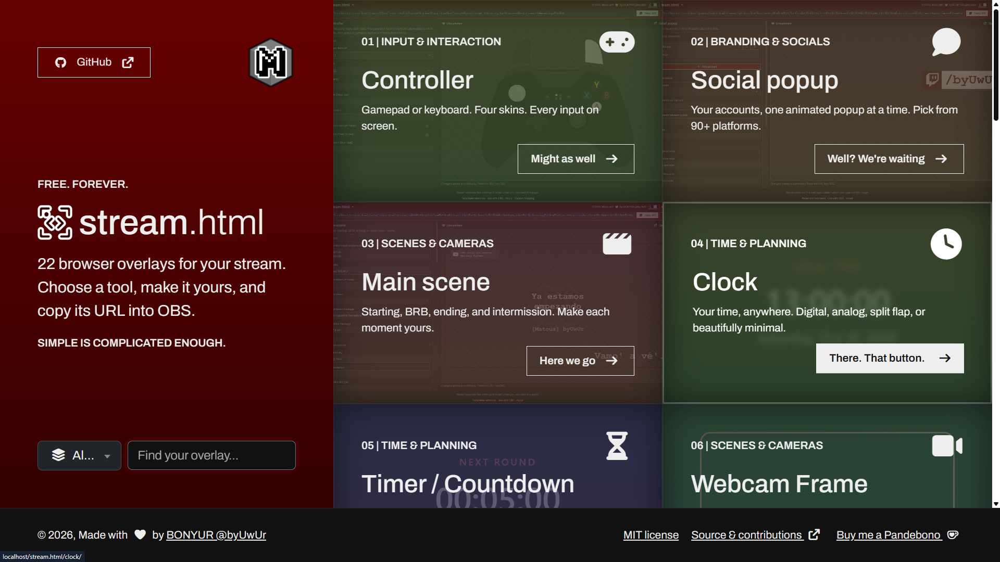
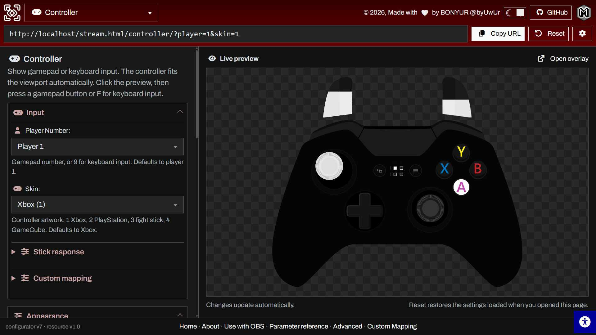
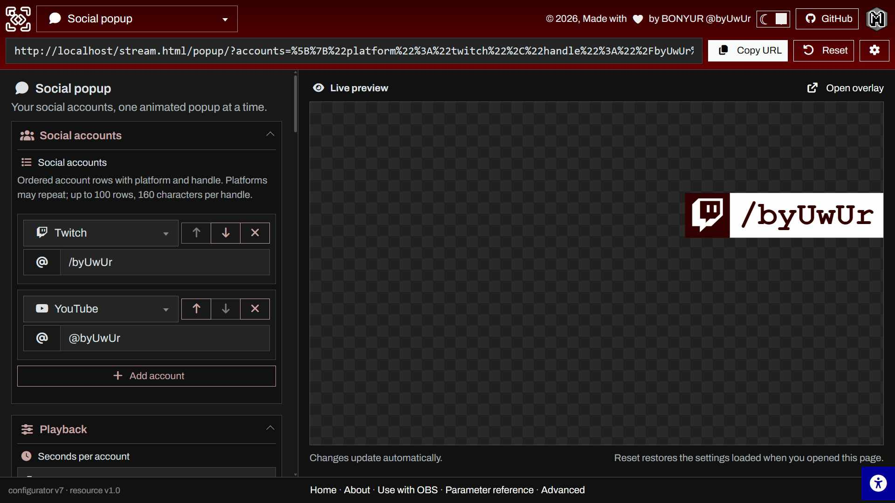
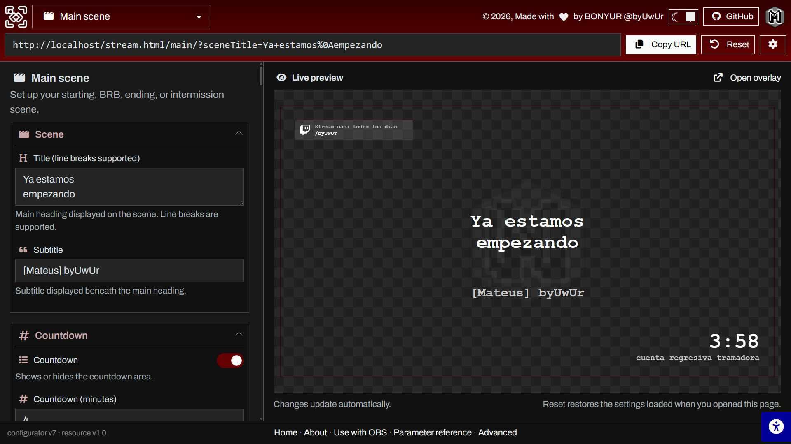

# byuwur/stream.html

Browser overlays for your stream. Choose a tool, make it yours, and copy its URL into OBS. Free. Forever.

[Open stream.html](https://byuwur.github.io/stream.html/) · [Configurator demo](https://byuwur.github.io/stream.html/configurator.html)

## Ready to use

| Tool                                                           | What it does                                                                                       | Local entry point       |
| -------------------------------------------------------------- | -------------------------------------------------------------------------------------------------- | ----------------------- |
| [Controller](https://byuwur.github.io/stream.html/controller/) | Gamepad or keyboard input. Xbox, PlayStation, fight-stick, and GameCube skins.                     | `controller/index.html` |
| [Social popup](https://byuwur.github.io/stream.html/popup/)    | Animated account rotation with 90+ platforms, colors, fonts, and timing.                           | `popup/index.html`      |
| [Main scene](https://byuwur.github.io/stream.html/main/)       | Starting, BRB, ending, and intermission scenes with branding, countdown, accounts, and a schedule. | `main/index.html`       |

1. Open a tool, adjust its fields, and check the live preview.
2. Click **Copy URL**.
3. Add an OBS **Browser** source and paste the URL with **Local file** unchecked.

Use **1920 × 1080** for Main scene. Size Controller and Popup for your layout; the preview shows the actual overlay at a smaller scale. No account, upload, package install, or build step.

## Settings stay in the URL

- Bare folder or `index.html` URLs open the editor. Query settings without a hash render the overlay.
- Append `#configure` to edit an existing URL. Help links open the corresponding panel.
- **Reset** restores the settings, list order, and compression choices from when the page opened, including after direct URL edits.
- Form edits and same-tool URL edits apply after a 250 ms pause via SPA.js's shared `debounce()`, updating the form and preview in place. **Enter** or leaving the changed URL field applies immediately; links to another tool navigate then.
- Editing keeps the browser address unchanged. **Copy URL** shares the current overlay settings. Bare tool URLs resume the saved configuration; explicit query settings take priority, including on reload.
- Invalid form values stop URL generation and keep the last valid preview. Invalid or unknown URL parameters keep the defaults; empty text clears a field.

The form handles encoding. Display text stays text, and lists support add, edit, reorder, and remove. Colors use 3/4/6/8 hex digits without `#`, including alpha: `fontColor=fff`, `backgroundColor=00000000`. Runtime restores `#`; older encoded hashes work. Malformed colors pass to CSS; RGB/HSL/named colors are outside the contract. Theme preference is saved locally. Motion follows the tool's settings; explicit Off, None, and Static choices still apply.

Fonts search 350 Google families, system fonts, and custom installed families or CSS stacks. Selected fonts and visible samples load on demand. The font must be available on the OBS computer; missing families use each tool's fallback.

Media fields reference public HTTP(S) URLs or paths relative to the tool's HTML. Local file URLs require downloaded use. No uploads or Base64 `data:` media URLs. Keep private information out of shared URLs.

### Shorter URLs

Open **Advanced** from the toolbar gear or footer. Compression is raw DEFLATE plus unpadded Base64url; the panel shows length/savings and keeps the readable URL when shorter.

Form values, expanded sections, and Advanced options are remembered per resource. Only valid form values are saved, using the generated query's chosen compression format and readable fallback. Small configurations use a one-year cookie scoped to the resource folder; larger configurations, blocked cookies, and `file://` copies use local storage. Explicit URL settings and compression formats take priority. Overlays use their URL only; invalid or unavailable storage leaves editing usable.

| Mode            | URL representation                                                                                                  |
| --------------- | ------------------------------------------------------------------------------------------------------------------- |
| All settings    | `?data=<compressed ordinary query string>`; readable parameters alongside it override packed values.                |
| Selected fields | `?accounts=dr:<token>&mode=left`; checked fields compress independently and keep their names. Others stay editable. |

Plain values need no marker. Escape literal text starting with `dr:` or `raw:` as `raw:<original text>`; generated links do this automatically. `#configure` restores compression choices. Invalid compressed fields retain defaults without discarding valid neighbors; Advanced shows a warning.

Whole-query decoding is capped at one MiB. Individual values use the field's UTF-8 text limit, allowing up to four bytes per character, capped at one MiB. Media remains referenced by URL.

Each tool imports [SPA.js v20.5 `_functions.js`](https://cdn.jsdelivr.net/gh/byuwur/spa.js@v20.5/_functions.js) with a regular HTML script tag before `configurator.js`. For offline use, save the helper and update its `src`. These helpers need no jQuery/SPA initialization. Browsers without native raw-DEFLATE support can use readable links.

### Downloaded use

Keep the resource folder and its parent `configurator.js` and `configurator.css`. The shared runtime is required by both the renderer and editor; one HTML file is not a bundle.

Open `{tool}/index.html`, then copy the generated `file:///.../{tool}/index.html?...` URL into OBS with **Local file** unchecked. Keep the files at that path. Hosted URLs use directories, such as `controller/?player=1`.

CDN assets are pinned to `spa.js@v20.5`. Editors load jQuery, Bootstrap, Select2, Pickr, and common styles/helpers. Renderers use native JavaScript; Main and Popup also use GSAP, with MorphSVG for Popup. Font-enabled pages use the native `byFont` helper. Offline use needs saved CDN dependencies and updated imports; installed fonts need no Google request. Controller output uses local artwork and the shared runtime.

### Older URLs

Replace old `controller.html`, `popup.html`, and `main.html` filenames with the tool's folder, preserving parameters. Controller ignores legacy `scale`. Popup ignores pixel `fontSize`/`textYOffset` aliases, per-platform handles, and account counts. Main ignores old scene `mode`, `showBG`, `hideCountdown`, and weekday fields. Rebuild those settings with the current form.

## Controller

[Example: Player 1, Xbox](https://byuwur.github.io/stream.html/controller/?player=1&skin=1)

| Parameter            | Meaning                                                                                                                  |
| -------------------- | ------------------------------------------------------------------------------------------------------------------------ |
| `player`             | `1`–`4` for gamepads; `9` for keyboard. Default: `1`.                                                                    |
| `skin`               | `1` Xbox, `2` PlayStation, `3` fight stick, `4` GameCube.                                                                |
| `opacity`            | `0`–`1`.                                                                                                                 |
| `offset`, `deadzone` | Stick travel in pixels and deadzone threshold.                                                                           |
| `strength`, `curve`  | `strength=0` disables trigger meters; `curve=1` enables stick curving.                                                   |
| `rotation`           | Maximum steering-wheel rotation in degrees.                                                                              |
| `mapping`            | Binding array from **Custom Mapping**; `[]` uses standard controls. Older `{"mapping":[...]}` wrappers remain supported. |

Press a gamepad button for detection, or **F** for keyboard input. Click the preview or use OBS **Interact** to give it keyboard focus. Default bindings live in `bySettingsKB` inside `controller/index.html`; detection depends on the browser and operating system.

**Custom Mapping** lets you choose a base, capture raw inputs, and apply bindings. The renderer polls input and fits the selected skin to the viewport, with `0.5rem` vertical margins.

## Social popup

Pick a platform, enter its display handle, and reorder the accounts. Repeated platforms are allowed. Brand icons appear in the selector and overlay, with a globe fallback.

| Parameter                                                | Meaning                                                                                                                                                  |
| -------------------------------------------------------- | -------------------------------------------------------------------------------------------------------------------------------------------------------- |
| `mode`                                                   | `right` (default) or `left`.                                                                                                                             |
| `accounts`                                               | Up to 100 `{ "platform": "twitch", "handle": "YourChannel" }` entries; 160 characters per handle and 20,000 JSON characters total. `[]` hides the popup. |
| `pauseTime`, `inbetweenPauseTime`                        | Seconds per account and between cycles, `0`–`3600`. Defaults: five seconds each.                                                                         |
| `scale`                                                  | `0.1`–`5`, anchored to the selected top corner.                                                                                                          |
| `iconBoxColor`, `textBoxColor`, `iconColor`, `fontColor` | CSS colors, including HEX alpha.                                                                                                                         |
| `primaryFont`, `fontWeight`                              | Font family; weight `100`–`900` in steps of 100. Fallback: Courier, then monospace.                                                                      |
| `fontSizeRem`, `textYOffsetRem`                          | Text size `0.5`–`6.25` rem (default `4.5`); vertical offset `-6.25`–`6.25` rem.                                                                          |

Defaults are three accounts. Invalid JSON or unsupported platforms retain those defaults; blank handles keep their slots. Font readiness and refreshed measurements keep repeated animations aligned.

## Main scene

[Example: Starting soon](https://byuwur.github.io/stream.html/main/?sceneTitle=Starting+soon&tagline=Your+channel&countdownTime=5&displayBranding=no&displaySocial=no)

| Parameter | Meaning |
| --- | --- |
| `sceneTitle`, `tagline` | Title with line breaks, up to 300 characters; subtitle, up to 160. |
| `countdownTime`, `countdownMessage`, `countdownOverMessage` | Minutes (`0`–`1440`, default `4`) and text during/after the countdown. |
| `displayCountdown`, `displayBranding`, `displaySocial`, `displaySchedule`, `displayLabels` | `yes` or `no`. Branding toggles the logo; title and subtitle stay independent. |
| `primaryFont`, `titleSize`, `subtitleSize` | Font family and text sizes (`8`–`200` px), with Courier/monospace fallback. |
| `primaryTextColor`, `subTextColor`, `accentColor`, `frameColor`, `contentBackgrounds`, `backgroundColor` | CSS colors. The scene background defaults to transparent `#00000000`. |
| `frameWidth` | `0`–`100` px, available in the form and URL. |
| `logoUrl`, `logoOpacity`, `logoScale` | Image URL/path, opacity `0`–`1`, scale `0.1`–`5`. An empty URL uses the BONYUR logo; `displayBranding=no` hides it. |
| `backgroundType`, `backgroundUrl` | `video` or `image`, with an optional media URL/path. No background media is bundled. |
| `backgroundBlur`, `backgroundOverlayOpacity`, `backgroundOverlay` | Blur `0`–`100` px, tint opacity `0`–`1`, and tint color. |
| `accounts` | Popup's account format with an optional `heading` of up to 160 characters. Blank handles and `[]` hide accounts. |
| `scheduleEntries` | Up to seven `{ "day": "monday", "text": "Your activity" }` rows; weekdays may repeat. Text is limited to 160 characters, JSON to 4,000. `[]` hides the schedule. |

Accounts and schedule rows use the same list controls. Invalid lists retain defaults. Main's pixel parameters convert to rem at a 16px root. Follower, donation, and subscriber labels are editable display text; live service updates are not connected.

## Work in progress

The other 19 tools remain `ready: false`, hidden from the landing and navigation, pending manual testing and review. These are development notes, not a release announcement. Their defaults and full field descriptions live in the local forms.

| Folder         | Purpose and useful limits                                                                                                                                                            |
| -------------- | ------------------------------------------------------------------------------------------------------------------------------------------------------------------------------------ |
| `clock`        | Digital, analog, flip, or minimal clocks. Up to four zones; blank zone/locale follows OBS. Larger multizone layouts may need a taller source.                                        |
| `timer`        | Duration, deadline, elapsed, or restart timing. Timestamp modes survive reload; restart mode starts over. No shared pause/resume. Milliseconds update at 20 Hz.                      |
| `webcam`       | Decorative frame above a camera source. Transparent center; it cannot crop or mask the camera. Circle uses the smaller dimension.                                                    |
| `ticker`       | Scrolling or rotating messages. Scrolling uses measured repeats; other modes follow wall-clock time. No live feeds.                                                                  |
| `watermark`    | Text, monogram, or logo. Optional fades follow wall-clock time; paths and fonts must exist in OBS.                                                                                   |
| `lower-thirds` | Rotating names, subtitles, and optional images. Wall-clock order; no remote triggering. Missing images hide gracefully.                                                              |
| `qr`           | QR/link card using Nayuki's MIT encoder. Max 600 characters/1,200 UTF-8 bytes, four quiet-zone modules, opaque colors, and whole modules of at least 3 px. Scan the final broadcast. |
| `reminder`     | Timestamp-driven reminders with IANA quiet hours, including daylight saving. OBS must keep the source running.                                                                       |
| `badge`        | Custom LIVE/AFK/RECORDING styling. It does not detect stream or recording status.                                                                                                    |
| `credits`      | Scrolling categories and names, with optional looping. Speed uses pixels/second; reload starts the roll again.                                                                       |
| `schedule`     | Dated activities, preserving row order and highlighting every active overlap. End boundaries are exclusive; no calendar integration.                                                 |
| `sponsors`     | Rotating public logos and text. No sponsorship service; failed images leave text visible.                                                                                            |
| `info`         | Static information cards. Large boards scroll; shorten text or enlarge the source to show everything.                                                                                |
| `effects`      | CSS rain, snow, confetti, or symbols. Max 200 particles; low mode caps at 50. Motion Off gives a static pattern.                                                                     |
| `hud`          | Decorative viewfinder, REC, and live timestamp. CSS grain/scanlines; no camera control or recording.                                                                                 |
| `timeline`     | Timestamp progress. Zero before start, complete at end; reversed/equal ranges show an error.                                                                                         |
| `randomizer`   | Seeded draws may repeat. Manual draws use OBS Interact and update the page URL; OBS restart uses its saved source URL. No remote synchronization.                                    |
| `quotes`       | Configured quotations on a wall-clock rotation. No online quote feed.                                                                                                                |
| `shortcuts`    | Static key/action reference and optional QWERTY diagram. It does not monitor keyboard input.                                                                                         |

Most draft sources start at **960 × 540**; HUD uses **1280 × 720**. Adjust dimensions and width to fit your scene. Lists allow 40 entries, 160 characters per field, and 8,000 JSON characters unless a tool documents a narrower limit.

Date/time pickers use the editor computer's zone and serialize UTC. Direct timestamp URLs need `Z` or an explicit offset, such as `2026-10-14T18:00:00-05:00`. Generated start times are concrete, so supported timestamp modes survive reload; the OBS computer clock remains authoritative.

## Development

**Simple is complicated enough.** No build step. Shared setup belongs in `configurator.js`; rendering and tool-specific validation stay beside the resource.

| File                     | Responsibility                                                                                                             |
| ------------------------ | -------------------------------------------------------------------------------------------------------------------------- |
| `configurator.js`        | Native resource setup, validation, platform data and helpers; jQuery editor, widgets, URLs, help, theme, and tool catalog. |
| `configurator.css`       | Editor layout, Select2 styling, and transparent-preview checkerboard.                                                      |
| `{tool}/index.html`      | Overlay template, dependency declarations, and empty editor container.                                                     |
| `{tool}/{tool}.js`       | Resource definition and native rendering.                                                                                  |
| `{tool}/{tool}.css`      | Resource appearance.                                                                                                       |
| `spa.js@v20.5/_fonts.js` | Native font loading and optional jQuery/Select2 pickers.                                                                   |
| `configurator.html`      | Working starter with text, number, and color fields.                                                                       |
| `index.html`             | Landing, generated cards, filters, animations, and sharing metadata.                                                       |

### Resource contract

Each `DOMContentLoaded` handler declares a `resource` object. `fields` own parameter names, defaults, labels, sections, and constraints; renderer-only values go in `constants`. After declaring local validators/integrations, call `byConfigurator.initResource(resource, integrations?)`. It clones defaults, applies valid URL values, publishes `window.byStreamResource`, sets `window.byStreamOverlay`, and mounts `overlay-markup` in overlay mode. It returns the shared settings object.

Keep the font helper (when needed), resource script, and `configurator.js` deferred. Native helpers register before resource `DOMContentLoaded` handlers run. Editor scripts use `data-editor-src`; their styles start with `data-editor-style media="not all"`. The runtime loads editor dependencies in order and checks jQuery afterward. Renderers use the native helpers and need no editor widgets.

The HTML needs `<template id="overlay-markup">...</template>` and `

`. `byConfigurator.init()` generates the toolbar, fields, preview, and parameter help; repeated calls preserve the form and handlers. Only declared fields enter generated URLs. Controller's editor-only `controller/configurator.js` supplies `byConfigurator.configureResource(resource, editor)` for mapping and optional help panels.

| Metadata                                      | Purpose                                                                                                                                 |
| --------------------------------------------- | --------------------------------------------------------------------------------------------------------------------------------------- |
| `type`                                        | `text`, `number`, `url`, `textarea`, `select`, `switch`, `color`, `font`, `datetime`, `timezone`, `entries`, or Controller's `mapping`. |
| `default`, `label`, `section`, `description`  | Initial value, caption, group, and generated help.                                                                                      |
| `options`, `labels`                           | Allowed values and display labels.                                                                                                      |
| `min`, `max`, `step`, `maxlength`, `validate` | Constraints; a custom validator returns the parsed value or `null`.                                                                     |
| `checkedValue`, `uncheckedValue`              | Serialized switch values.                                                                                                               |
| `entries`                                     | Choices/key, text-field definitions, new-entry values, and row limit.                                                                   |
| `presets`                                     | Resource-level flag enabling editable appearance presets.                                                                               |

`byConfigurator.validParameter(fields, name, value)` and `applyParameters(fields, settings, values?)` share the same rules across editors and renderers. Native helpers also provide the platform catalog, account parsing (Main enables headings), locale/zone/timestamp parsing, image URL checks, and clock-aligned `watch()` updates that pause while hidden.

HTML needs `<template id="overlay-markup">...</template>` and `

`. Declare scripts with `src` and `defer` in dependency order: jQuery before its plugins, Popper before Bootstrap, and `_functions.js` before `configurator.js`. Deferred scripts execute in document order before `DOMContentLoaded`; initialization awaits decoded resource settings. Editor styles start with `data-editor-style media="not all"` and activate only in configure mode.

### Add a tool

1. Copy `configurator.html` to the new folder's `index.html`. Replace its demo markup, CSS, and renderer; change shared imports from `./` to `../`.
2. Define fields and native rendering; call `byConfigurator.initResource(resource)` before rendering when `byStreamOverlay` is true.
3. Add its folder ID, name, description, icon, category, and `ready` flag to `byConfigurator.catalog.tools`. Set `ready: true` after review and testing.

The catalog owns order, cards, overlay count, and navigation. IDs derive folder URLs and `prev.jpg`; missing previews leave a blank background. Changes apply on the next page load; static hosting does not discover folders. Categories cover scenes/cameras, input/interaction, time/planning, branding/socials, and text/information.

### Landing and checks

The introduction uses one third of desktop width; mobile stacks it above the gallery. Search/categories filter ready tools. One result fills the gallery; two or three stack in full-width rows; four use quadrants; five use two above three; six or more use a scrolling two-column grid. Hover/focus activates the card's action and blurs its preview by `0.25rem`. Animate.css handles entrance fades; View Transitions animate filtering when supported, with immediate filtering as fallback.

Cards reuse `byCommon.randomCTAMessage()` and `randomAccentColor()`. Share previews are static: root `prev.jpg` is 1920 × 1080, and tools use their own images. Update Open Graph/Twitter metadata with the images.

Run `node --check` on changed scripts. Check HTTP and `file://` editors/renderers, URL round trips, `#configure`, copy/reset, invalid values, lists, fonts, and keyboard mapping. Overlay mode should load native helpers without jQuery or editor widgets. External Playwright/Chrome checks need no dependency installed in this repository; QR scan checks additionally need a decoder. Browser checks do not replace OBS or endurance testing.

## Other configurations and assets

These need their corresponding application or service:

| Folder / file                                              | Use                                                                                                              |
| ---------------------------------------------------------- | ---------------------------------------------------------------------------------------------------------------- |
| `alert-box.streamlabs.com/`, `chat-box.streamlabs.com/`    | Streamlabs custom widgets; copy HTML/CSS/JS and fields into the service editor. Chat is not a standalone client. |
| `dashboard.twitch.tv/`                                     | Twitch alert templates with service placeholders.                                                                |
| `deckboard.app/`                                           | Deckboard board exports; adapt scene names and paths.                                                            |
| `InputOverlay.OBS/`                                        | Layouts and artwork for the OBS Input Overlay plugin, separate from Controller.                                  |
| `obs-studio/`                                              | Personal profiles, scenes, plugins, and caches; not a portable installation.                                     |
| `foobar2000.org/`                                          | Player, components, profile, and current-song output.                                                            |
| `_byuwur.OBS/`, `_generic.OBS/`, `_overlays.OBS/`, `_art/` | Branding, transitions, backgrounds, artwork, and editable media.                                                 |

Back up your settings before importing exports. Replace devices, local paths, and account settings. Keep stream keys, WebSocket passwords, and private widget URLs out of shared exports.

## License

Project code: [MIT](LICENSE.md), copyright Andrés Trujillo [Mateus] byUwUr. Bundled libraries, applications, and media retain their own licenses.
