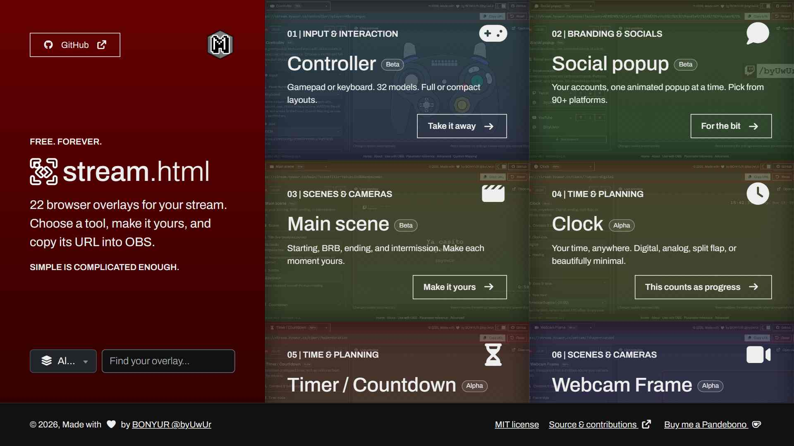
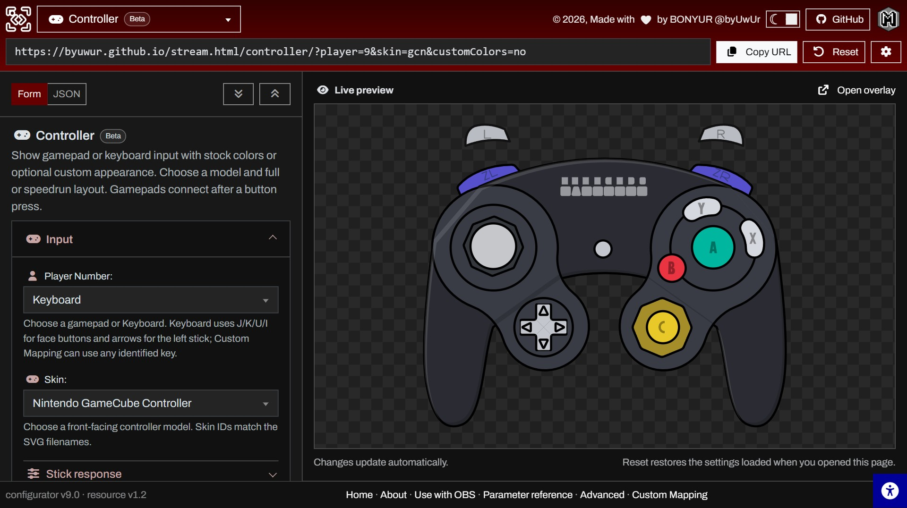
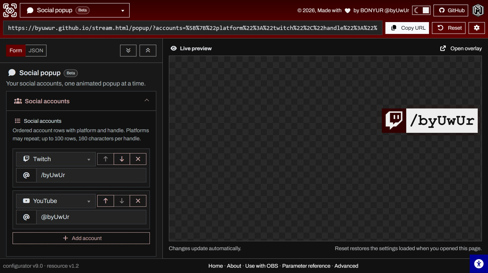
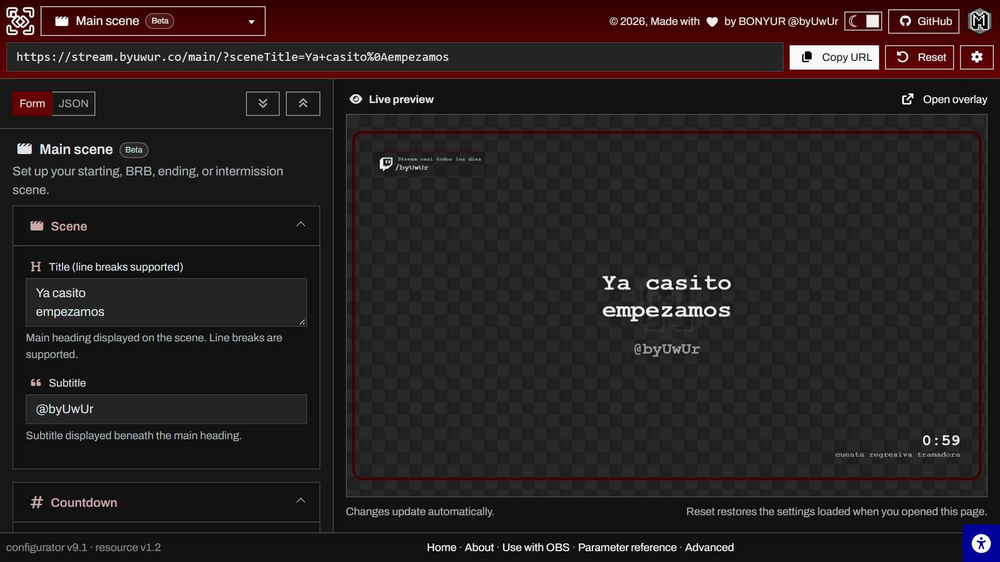

# byuwur/stream.html

Browser overlays for your stream. Configure a tool and copy its URL into OBS. Free. Forever. No account, upload, install, or build step.

[Open stream.html](https://byuwur.github.io/stream.html/) · [Configurator demo](https://byuwur.github.io/stream.html/configurator.html)

## Available overlays

All 22 overlays are available as prereleases. **Alpha** means early testing; **Beta** means broader testing. Features may change, and bugs are expected. Try your setup before going live. Status pills appear beside tool titles on the landing page, in the tool picker, and in the configurator heading.

| Tool                                                                       | Status | Purpose                                                                                    | Local entry point         |
| -------------------------------------------------------------------------- | ------ | ------------------------------------------------------------------------------------------ | ------------------------- |
| [Controller](https://byuwur.github.io/stream.html/controller/)             | Beta   | Gamepad/keyboard input with Xbox, PlayStation, fight-stick, and GameCube skins. | `controller/index.html`   |
| [Social popup](https://byuwur.github.io/stream.html/popup/)                | Beta   | Animated accounts with 90+ platforms, fonts, colors, and timing.                           | `popup/index.html`        |
| [Main scene](https://byuwur.github.io/stream.html/main/)                   | Beta   | Starting/BRB/ending scenes with branding, countdown, accounts, and schedule.               | `main/index.html`         |
| [Clock](https://byuwur.github.io/stream.html/clock/)                       | Alpha  | Digital, analog, split-flap, and minimal clocks.                                           | `clock/index.html`        |
| [Timer / Countdown](https://byuwur.github.io/stream.html/timer/)           | Alpha  | Countdown or elapsed timer with an optional fixed start.                                   | `timer/index.html`        |
| [Webcam Frame](https://byuwur.github.io/stream.html/webcam/)               | Alpha  | Transparent frame for your camera.                                                         | `webcam/index.html`       |
| [Ticker](https://byuwur.github.io/stream.html/ticker/)                     | Alpha  | Scrolling news, commands, and reminders.                                                   | `ticker/index.html`       |
| [Watermark](https://byuwur.github.io/stream.html/watermark/)               | Alpha  | Text, monogram, or logo branding.                                                          | `watermark/index.html`    |
| [Lower Thirds](https://byuwur.github.io/stream.html/lower-thirds/)         | Alpha  | Broadcast cards for guests, games, and moments.                                            | `lower-thirds/index.html` |
| [QR / Link Card](https://byuwur.github.io/stream.html/qr/)                 | Alpha  | Locally generated QR code and link card.                                                   | `qr/index.html`           |
| [Periodic Reminder](https://byuwur.github.io/stream.html/reminder/)        | Alpha  | Automatic reminders on your schedule.                                                      | `reminder/index.html`     |
| [Stream Badge](https://byuwur.github.io/stream.html/badge/)                | Alpha  | LIVE, AFK, recording, and custom labels.                                                   | `badge/index.html`        |
| [Credits Roll](https://byuwur.github.io/stream.html/credits/)              | Alpha  | Closing credits for your community.                                                        | `credits/index.html`      |
| [Schedule](https://byuwur.github.io/stream.html/schedule/)                 | Alpha  | Dated run of show with current-segment highlighting.                                       | `schedule/index.html`     |
| [Sponsor Carousel](https://byuwur.github.io/stream.html/sponsors/)         | Alpha  | Rotating public logos and messages.                                                        | `sponsors/index.html`     |
| [Info Board](https://byuwur.github.io/stream.html/info/)                   | Alpha  | Rules, game settings, commands, and other stream details.                                  | `info/index.html`         |
| [Screen Effects](https://byuwur.github.io/stream.html/effects/)            | Alpha  | Rain, snow, confetti, and floating symbols.                                                | `effects/index.html`      |
| [Camera HUD](https://byuwur.github.io/stream.html/hud/)                    | Alpha  | Recording indicator, timecode, and camera styling.                                         | `hud/index.html`          |
| [Progress Timeline](https://byuwur.github.io/stream.html/timeline/)        | Alpha  | Progress from a starting time to an ending time.                                           | `timeline/index.html`     |
| [Randomizer](https://byuwur.github.io/stream.html/randomizer/)             | Alpha  | Seeded draws for challenges, games, and choices.                                           | `randomizer/index.html`   |
| [Quote Display](https://byuwur.github.io/stream.html/quotes/)              | Alpha  | Rotating quotes, tips, and trivia.                                                         | `quotes/index.html`       |
| [Keyboard Shortcut Sheet](https://byuwur.github.io/stream.html/shortcuts/) | Alpha  | Editable shortcut guide without keyboard monitoring.                                       | `shortcuts/index.html`    |

Open a tool, adjust its fields, check the preview, then **Copy URL** into an OBS **Browser** source with **Local file** unchecked. Use **1920 × 1080** for Main; size Controller/Popup to your layout.

Help improve stream.html on GitHub: [contribute a pull request](https://github.com/byuwur/stream.html/pulls) or [report an issue](https://github.com/byuwur/stream.html/issues). Bug reports, ideas, and fixes are welcome; see [Contributing](CONTRIBUTING.md).

## Settings stay in the URL

- Bare folder/`index.html` URLs open the editor; query settings without a hash render the overlay.
- Press **F2** to switch between the configurator and its current overlay, or append `#configure` to edit a link. In OBS, use **Interact** first. F2 is ignored in preview frames, with modifiers/repeats, and while typing in overlay controls.
- In the configurator, press **F1** to open **About**.
- Form edits and same-tool URL edits apply after a 250 ms pause via SPA.js's shared `debounce()`, updating the form and preview in place without adding browser history entries. **Enter** or leaving the changed URL field applies immediately; links to another tool navigate then.
- The sticky settings toolbar switches between **Form** and editable **JSON**. JSON uses field IDs and native values, showing mandatory overlay fields plus non-default settings; **Show all fields** includes every editable field, including defaults and conditional fields. Missing keys restore resource defaults; invalid JSON, unknown keys, and invalid values keep the last valid preview. JSON edits use the same 250 ms debounce. Both JSON views are prepared with accepted URL updates; switching views reuses that content. The JSON editor fills the remaining settings-panel space and adapts to viewport changes. **Copy** copies the displayed JSON. Form's **Expand All** / **Collapse All** icons control sections and subsections; their tooltips appear below the buttons. Accessibility tooltips open to the left.
- Editing keeps the browser address unchanged. **Copy URL** shares the current overlay settings. Bare tool URLs resume the saved configuration; explicit query settings take priority, including on reload.
- **Reset** restores the settings, list order, and compression choices from when the page opened, including after direct URL edits.
- **Advanced → Restore resource defaults** clears this resource's saved configuration and reloads the defaults declared in its JavaScript.
- Invalid form values keep the last valid preview and stop URL generation. Invalid/unknown URL values retain defaults. Clearing display text leaves it empty and hides its container; whitespace-only text also becomes empty. Clearing other resource fields restores their defaults. List editors retain their row editing and validation behavior.

Generated links include only values that differ from the declared defaults, plus each resource's explicit `urlRequired` fields. Off/default appearance values are omitted, and missing parameters use resource defaults. Controller always includes `player` and `skin`; Popup includes `accounts`; Main includes `sceneTitle`. Imports use defaults for missing values; empty text stays empty and its text container is hidden. Cleared numbers and invalid zero values restore their field defaults when editing finishes; opening a bare editor still resumes saved preferences. Explicit empty arrays/maps such as `accounts=[]` remain valid ways to remove list content.

The form handles encoding and list add/edit/reorder/remove. Colors use 3/4/6/8 hex digits without `#`, including alpha: `fontColor=fff`, `backgroundColor=00000000`. Runtime restores `#`; older encoded hashes work. Invalid colors retain defaults; RGB/HSL/named colors are outside the contract.

Fonts include 350 Google families, system fonts, and installed families/CSS stacks. Fonts and visible samples load on demand; OBS needs access to the chosen font or uses the tool's fallback. Theme preference is local. Every resource has an **Animate** switch, On by default and independent of the system reduced-motion preference. Off disables resource motion while preserving content updates, timing, and gamepad input. The configurator keeps its own animations. Timer and Timeline bars and rings interpolate from the clock between text updates; this pauses while hidden and becomes immediate clock ticks with Animate Off.

All 22 resources keep transparent canvases. Resource defaults use the BONYUR palette: off-white `#eee`, charcoal `#111`, dark crimson `#600`/`#300`. Compact cards favor 40% charcoal surfaces, 12 px backdrop blur, 8–12 px padding, 6 px corners, and faint borders/shadows. Main retains its 6 px dark-crimson frame, inset 24 px, with transparent space inside and blur on its cards. Popup uses 40% charcoal and crimson surfaces and blurs its text box; Webcam blurs only its label so camera content stays clear. Text sizes keep labels and supporting copy close to their main value; Clock defaults to 32 px digits with 20 px labels/date. Clock starts as a single horizontal line; Timer, Timeline, QR, Schedule, and shortcut layouts favor compact rows. Main and Popup use the same palette, with ready-to-edit byUwUr content. Camera and effects canvases retain transparent content areas. Text uses `"Courier New", Courier, monospace`; the configurator uses Archivo. Explicit URL settings override the defaults, and the BONYUR appearance preset restores the card palette without replacing content or layout.

Backdrop blur samples content within the same browser page; it cannot blur other OBS sources underneath the Browser Source. Use background alpha for translucent surfaces; overall opacity below 100% can isolate the backdrop and suppress the blur.

Shadow and glow switches remain independent. Card shadows start On with 8% black and soft edges; glows remain Off. Turn either layer off or adjust its color, softness, and spread. Generated URLs omit whichever values match that resource's defaults.

Main offers countdown formats for hours/minutes/seconds, total minutes, total seconds, or unit labels. Formats change the display, not the countdown duration.

Timer, Timeline, Reminder, and timed Randomizer start when the overlay page loads. **Use fixed start time** (`useStartTime=yes`) is Off by default and reveals the start timestamp when enabled. Fixed anchors survive copied URLs and reloads; inactive timestamps are omitted. Timeline uses `duration` (seconds, default `3600`) on load, or its start/end timestamps with the switch On. Timer deadline mode still uses an absolute end time; Restart always starts on load. Existing links with a start timestamp need `useStartTime=yes` to retain their fixed schedule. Schedule activities keep their explicit calendar dates.

Media fields reference public HTTP(S) URLs or paths relative to the tool HTML. Local file URLs need downloaded use. No uploads or Base64 `data:` media. Keep private information out of shared URLs.

### Keyboard shortcuts

About includes the shortcut reference. Focus the configurator to use these:

| Shortcut            | Action                                          |
| ------------------- | ----------------------------------------------- |
| `F1`                | Open About.                                     |
| `F2`                | Switch between configurator and overlay.        |
| `Alt+Shift+P`       | Open Parameters.                                |
| `Alt+Shift+A`       | Open Advanced options.                          |
| `Alt+Shift+O`       | Open the current overlay in a new tab.          |
| `Alt+Shift+C`       | Copy the overlay URL.                           |
| `Alt+Shift+U`       | Focus and select the overlay URL.               |
| `Alt+Shift+M`       | Open the tool picker.                           |
| `Esc`               | Close the current dialog, popover, or dropdown. |
| `Tab` / `Shift+Tab` | Move between controls.                          |

`F2` switches modes on standalone pages and is ignored inside previews. F3/F4 retain browser actions. Modified or repeated function keys, repeated shortcuts, and IME composition are ignored.

### Shorter URLs

Open **Advanced** from the toolbar gear or footer. Compression is raw DEFLATE plus unpadded Base64url; the panel shows length/savings and keeps the readable URL when shorter.

Form values, expanded sections, and Advanced options are remembered per resource. Only valid form values are saved, using the generated query's chosen compression format and readable fallback. Small configurations use a one-year cookie scoped to the resource folder; larger configurations, blocked cookies, and `file://` copies use local storage. Explicit URL settings and compression formats take priority. Overlays use their URL only; invalid or unavailable storage leaves editing usable.

| Mode            | URL representation                                                                                                  |
| --------------- | ------------------------------------------------------------------------------------------------------------------- |
| All settings    | `?data=<compressed ordinary query string>`; readable parameters alongside it override packed values.                |
| Selected fields | `?accounts=dr:<token>&mode=left`; checked fields compress independently and keep their names. Others stay editable. |

Plain values need no marker. Escape literal text starting with `dr:` or `raw:` as `raw:<original text>`; generated links do this automatically. `#configure` restores compression choices. Invalid compressed fields retain defaults without discarding valid neighbors; Advanced shows a warning.

Whole-query decoding is capped at one MiB. Individual values use the field's UTF-8 text limit, allowing up to four bytes per character, capped at one MiB. Media remains referenced by URL.

Each tool imports [SPA.js `_functions.min.js`](https://cdn.jsdelivr.net/gh/byuwur/spa.js@latest/_functions.min.js) with a regular HTML script tag before `resource.js`. For offline use, save the helper and update its `src`. These helpers need no jQuery/SPA initialization. Browsers without native raw-DEFLATE support can use readable links.

### Downloaded use

Keep the tool folder plus parent `resource.js` and its renderer dependencies. Keep `configurator.js`/`configurator.css` when editing is needed; overlays still work when the configurator script or the whole configurator markup/dependency section is removed. A single HTML file is not a bundle. Controller requires HTTP/HTTPS to load its editable SVG resources; the local-file instructions below apply to the other overlays. Open `{tool}/index.html` and paste its generated `file:///.../index.html?...` URL into OBS with **Local file** unchecked. Keep those paths stable. Hosted links use tool directories.

Pages import jQuery, Popper, Bootstrap, Select2, Pickr, and common assets directly in HTML, pinned to `spa.js@v20.7`. Editor setup runs only in configure mode; renderers use native JavaScript. Main/Popup also use GSAP and Popup uses MorphSVG. Font-enabled pages use native `byFont`. Offline use requires saved CDN dependencies and updated `src`/`href` paths.

### Older URLs

Replace `controller.html`, `popup.html`, or `main.html` with its tool folder. Rebuild retired settings in the form: Controller `scale`; Popup `fontSizeRem`/`textYOffsetRem` (now `fontSize`/`textYOffset` in pixels), per-platform handles/account counts; Main scene `mode`, `showBG`, `hideCountdown`, and weekday fields.

Current URLs use percentages for opacity, deadzone, and scale: `100` means 100%, and `25` means 25%. Replace older fractional values explicitly; they are not converted. Social accounts use ordered rows so platforms may repeat; Main schedule entries use weekday maps. Unsupported list shapes retain defaults rather than being migrated. The form and Parameters dialog show the current fields and accepted values.

## Controller

[Example: Player 1, Xbox](https://byuwur.github.io/stream.html/controller/?player=1&skin=1)

| Parameter                                | Meaning                                                                             |
| ---------------------------------------- | ----------------------------------------------------------------------------------- |
| `player`                                 | Gamepads `1`–`4` (default `1`); keyboard `9`.                                       |
| `skin`                                   | `1` Xbox, `2` PlayStation, `3` fight stick, `4` GameCube.                           |
| `opacity`                                | `0`–`100`%; default `100`.                                                          |
| `offset`, `deadzone`                     | Stick travel in pixels; deadzone `0`–`100`% (default `25`).                         |
| `strength`, `curve`                      | `strength=0` disables trigger meters; `curve=1` enables stick curving.              |
| `rotation`                               | Maximum steering-wheel rotation in degrees.                                         |
| `mapping`                                | Custom Mapping binding array; `[]` uses defaults. Legacy `{"mapping":[...]}` works. |
| `mirror`, `fitMargin`                    | Mirror artwork horizontally; vertical fit margin in pixels (default `8`).           |
| `horizontalPosition`, `verticalPosition` | Signed pixel offsets from the viewport center; both default to `0`.                 |

Press a gamepad button for detection or **F** for keyboard input. Focus the preview/OBS Interact first. Keyboard defaults live in `bySettingsKB` in `controller/index.html`; detection depends on browser/OS. **Custom Mapping** chooses a base and captures bindings. Skins fit the viewport automatically. Appearance controls also expose background, disconnected opacity, scale, tilt, offsets, and artwork filters.

## Social popup

Choose platforms, handles, and order. Repeated platforms are allowed. Brand icons use a globe fallback.

| Parameter | Meaning |
| --- | --- |
| `mode` | `right` (default) or `left`. |
| `accounts` | Ordered rows, e.g. `[{"platform":"twitch","handle":"/byUwUr"},{"platform":"twitch","handle":"/byUwUr_es"}]`; up to 100 accounts, 160 characters/handle, 20,000 JSON characters. `[]` hides it. |
| `pauseTime`, `inbetweenPauseTime` | Seconds/account and between cycles: `0`–`3600`, default `3` each. |
| `animationSpeed` | Playback speed `0`–`500`%; `100` is normal and `0` pauses animation. |
| `scale` | `-500`–`500`%, anchored to the selected top corner; `100` keeps the original size. |
| `iconBoxColor`, `textBoxColor`, `iconColor`, `fontColor` | Hex colors without `#`; defaults use deep red `#600`, off-white `#eee`, and translucent charcoal. |
| `primaryFont`, `fontWeight` | Font family and weight `100`–`900`, step `100` (default `600`); Courier/monospace fallback. |
| `fontSize`, `textYOffset` | Size `8`–`100` px (default `48`); offset `-100`–`100` px. |
| `opacity`, `cornerInset`, `textPadding` | Optional opacity `0`–`100`%, signed corner inset on both axes, and horizontal text padding in pixels. |

Invalid JSON/platforms retain the two byUwUr default accounts; blank handles keep their slots. Font readiness and remeasurement keep animation aligned. Separate account-name and icon typography, text-box borders/shadows, placement, and filters are available in the form.

## Main scene

[Example: Starting soon](https://byuwur.github.io/stream.html/main/?sceneTitle=Starting+soon&tagline=Your+channel&countdownTime=5&displayBranding=no&displaySocial=no)

| Parameter | Meaning |
| --- | --- |
| `sceneTitle`, `tagline` | Multiline title up to 300 characters; subtitle up to 160. |
| `countdownTime`, `countdownMessage`, `countdownOverMessage` | Minutes `0`–`1440` (default `4`); during/after messages. |
| `countdownFormat` | `stopwatch` (total minutes/seconds, default), `clock`, `hours`, `units`, or total `seconds`. |
| `displayCountdown`, `displayBranding`, `displaySocial`, `displaySchedule`, `displayLabels` | `yes`/`no` toggles. Branding hides only the logo. |
| `primaryFont`, `titleSize`, `subtitleSize` | Font family and sizes `8`–`200` px; Courier/monospace fallback. |
| `primaryTextColor`, `subTextColor`, `accentColor`, `frameColor`, `contentBackgrounds`, `backgroundColor` | Hex without `#`; background defaults to transparent `00000000`, accent and frame to dark crimson `440000` at 8 px. |
| `frameWidth`, `frameInset` | Border thickness `0`–`100` px (default `6`); optional signed inset in pixels. |
| `logoUrl`, `logoOpacity`, `logoScale` | Image URL/path (default `https://byuwur.github.io/img/logo.png`), opacity `0`–`100`% (default `4`), scale `-500`–`500`% (default `100`). |
| `displayBackground`, `backgroundType`, `backgroundUrl`, `backgroundScale` | Media toggle (Off by default), `image`/`video`, media URL/path, and scale `-500`–`500`%. Enable the toggle to show media; the default URL is the BONYUR logo. |
| `backgroundBlur`, `backgroundOverlayOpacity`, `backgroundOverlay` | Blur `0`–`100` px, tint opacity `0`–`100`%, tint color. |
| `accounts` | Ordered rows with `platform`, `handle`, and `heading`; platforms may repeat. Up to 100 rows, 160 characters per text field, 20,000 JSON characters. Blank handles/`[]` hide accounts. |
| `scheduleEntries` | Weekday-to-text map, e.g. `{"monday":"Activity"}`; up to seven days, 160 characters/text, 4,000 JSON characters. `{}` hides it. |
| `animationSpeed` | Social animation speed `0`–`500`%; `100` is normal and `0` pauses animation. |

Invalid lists retain defaults. Individual controls cover title/subtitle, countdown and completion text, social names/icons, schedule text, event headings, card surfaces, and scene filters. Each visible section has its own positioning or scale controls where applicable. Follower/donation/subscriber labels are editable text, without live service updates.

## Development

Native overlay setup and shared helpers belong in `resource.js`, exposed as `byStream`. Its JSDoc defines `ResourceField`, `ResourceFields`, `ResourceSettings`, and `ResourceDefinition`, with detailed contracts for reusable utilities and non-obvious behavior. Resources declare their fields and defaults, then use those helpers. Tool definitions/rendering and CSS live in `{tool}/{tool}.js` and `.css`. The optional `configurator.js` owns the editor, preferences, help, preview, and tool catalog; `configurator.css` owns editor styling. Resources declare Animate.css alongside their editor stylesheet imports; those styles activate only in configure mode. Editor motion timing is controlled by `--settings-motion-duration` and `--settings-collapse-duration` in `configurator.css`. Rotating cards use `contentTransition()` for exit, container resizing, and entry; incoming content stays hidden until it fits, and newer updates cancel stale transitions. Sections and subsections reuse Bootstrap Collapse; subsection toggles use less padding and lighter text. Revealed fields combine an Animate.css fade with an 8 px horizontal entry. Panels, fields, lists, feedback, accessibility menus, and Select2 dropdowns share a short slide/fade from the left. Departing content is immediately inert and hidden after their exit; rapid switches supersede earlier effects. Help tabs exit before the next page enters, and open containers interpolate height changes. Bootstrap retains height ownership during collapse transitions. Tooltips retain the shared instant behavior; controls transition their hover, focus, and toggle colors. Switches use the same thicker Bootstrap size. Select2 highlights enter from the left and leave to the right for pointer and keyboard navigation on the landing and in the configurator. These finite effects remain enabled with reduced motion; shared controls retain their own transition rules. Keep custom CSS for theme and widget/layout integration. `configurator.html` is the starter, and the root `index.html` renders the catalog.

### Resource contract

In an async `DOMContentLoaded` handler, define `resource.fields` with parameter names, types, defaults, labels, sections, descriptions, and constraints. Put renderer-only values in `constants`, then call `await byStream.initResource(resource, integrations?)` before rendering. It decodes/validates URL settings, clones defaults, publishes `window.byStreamResource`/`window.byStreamOverlay`, mounts `overlay-markup` in overlay mode, and resolves to shared settings. Resource scripts use `byStream` and never require `byConfigurator`.

Declare a nonempty `resource.urlRequired` array of field names retained in generated links while active, including when they use defaults. Keep at least one required field unconditional so default links stay in overlay mode. This keeps overlay URLs query-based without emitting unrelated defaults. Include timestamps or scheduled entries whose initial values must survive reloads. Other values are compared against `field.default`; object/array order is preserved, and equivalent hex color spellings compare as the same color. Declare concrete valid defaults directly.

`byStream.settingsURL(resource, settings)` builds the same readable URL for editor actions and native resource interactions, including after importing a compressed URL.

HTML needs `<template id="overlay-markup">...</template>`; add `

` for the optional editor. Declare scripts with `src` and `defer` in dependency order: `_functions.js` before `resource.js`, then the resource script; jQuery before its plugins and Popper before Bootstrap. Keep fonts and renderer libraries outside the configurator section. Deferred scripts execute in document order before `DOMContentLoaded`; the resource handler registers before the editor startup handler. Editor styles start with `data-editor-style media="not all"` and activate only in configure mode. Overlay mode needs `resource.js`, the resource script, and renderer dependencies; it does not use the configurator UI or jQuery.

`byConfigurator.init()` generates controls, preview, and parameter help; repeat calls preserve the form/handlers. Only declared fields enter URLs. `byStream.validParameter(fields, name, value)` and `byStream.applyParameters(fields, settings, values?)` share validation; custom validators return a parsed value or `null`. See the starter and existing resources for field metadata. Controller's `byConfigurator.configureResource(resource, editor)` adds mapping/help panels. Native helpers supply platforms/accounts, dates/zones, image checks, and clock-aligned `watch()` updates that pause while hidden.

The runtime exposes `byStream.ready`, the same promise returned by `initResource()`. Before initialization, the optional configurator attaches `byStream.prepareResource(resource)` to read editor preferences and choose its input query. The runtime calls that hook only in configure mode; overlays always read their URL alone. The editor awaits `ready` and reads transport warnings/compression choices from `byStreamResource.urlParameters`. Neither preferences nor editor startup changes the native initializer.

Declare sections, subsections, and fields in display order: primary content and behavior first, then common appearance, size and placement, composition, and detailed styling or effects. Keep related fields together; appearance presets belong in Appearance.

Resource size and offset controls use pixels, including the configurator demo. The configurator interface keeps its rem-based styling. Opacity, deadzone, fades, grayscale, sepia, and invert use `0`–`100`%. Animation speed, brightness, contrast, and saturation accept `0`–`500`%, with `100` as normal. Scale uses `-500`–`500`%, where `100` preserves size and negative values flip both axes. URL values use these same units.

Field `options` maps stored IDs to displayed labels. Selects show named defaults or Off where an override can be disabled, including the scale/tilt origin. Binary settings use `type: "switch"` with explicit checked/unchecked values. Every field has an icon, with explicit `icon` metadata taking priority over the shared property/purpose choices. `textFields()`, `surfaceFields()`, `placementFields()`, and `layoutFields()` return ordinary fields with concrete defaults. Missing/empty scalar defaults receive neutral values: `0` for offsets/tilt/spacing, `100` for scale/opacity, Courier New for fonts, white or transparent colors, and valid select choices. Numeric fallbacks respect the field's bounds. Resources can replace a generated field's `.default` before `initResource()`; supplied values, including `0` and `false`, take precedence. Neutral generated values preserve base CSS through `styleDefault`; resource-specific defaults that differ from that value apply normally. Text sizes, line heights, and other fields marked `zeroIsDefault` expose their concrete resource defaults; entering `0` or clearing them restores that displayed value. Legacy zero URL/JSON values normalize through the same rules. Maximum width `0` fits content; the Fill width toggle appears directly below Width only at `0` and switches it to available-width sizing. Camera frames, Info Board, and Schedule default to filling the available width. Clearing a field restores its resource default; the Reset button restores the opening configuration. Lower order values appear first; changing order enables a flex layout.

Maximum widths and heights accept `0` for Auto: no fixed maximum. Positive values set a pixel cap; zero never collapses the element. This includes panel widths, list/board heights, and logo limits. Use 0 for Sponsor image width or Lower Thirds image size to let the image size itself proportionally. Other numeric controls, such as opacity, retain their literal zero behavior. Schedule, Info Board, and Shortcuts default to `0` columns, fitting their existing items to the available width. Credits viewport height `0` fills the available height. Credits enter from below when scrolling up and from above when scrolling down. Looping credits repeat continuously after entering. Viewport edge padding and the corresponding frame/corner/fit insets default to 16 px.

Optional display text may have an empty default; do not use a space as a placeholder. Optional non-text features use explicit switches. Main background media starts Off while retaining a valid image URL. Regional controls show the current computer's time zone and browser locale. Generated URLs still omit default values.

Declare image paths in resource field defaults; renderers read the resolved settings instead of embedding fallback image paths in CSS or markup.

Shadows, glows, filters, offsets, element edges, and fades use numeric inputs, color pickers, and choices in dedicated subsections. Position and offset controls accept positive and negative values. Inactive effect controls are hidden and disabled; selecting a custom effect reveals its settings. Raw CSS-string parameters are no longer fields and fall back to defaults. The `shadowFields()`, `filterFields()`, `offsetFields()`, `insetFields()`, and `fadeFields()` helpers declare these ordinary URL fields.

They use `styleSelector`, `styleProperty`, and either `styleUnit` or a `styleValue(settings)` function to build the CSS after validation, including for rotating content and downloaded overlays.

Field `subsection` groups related controls. `when: [fieldName, ...values]` shows a field only for those parent values; omitting values requires nonempty parent text. Hidden parents also hide their descendants. Inactive controls are disabled and do not block validation. Their drafts return when re-enabled in the current editor, but overlays treat inactive switches as Off, reset other inactive settings to their declared defaults, and skip their style overrides. Inactive fields are omitted from generated URLs; mandatory fields are always retained while active. Conditions reference existing fields and must not form cycles. Empty subsections and sections are hidden. `whenFields(condition, fields)` applies one condition to a group. `textFields(elements, conditions)` and `surfaceFields(elements, conditions)` accept conditions keyed by element name.

Shared `dateTimeFields()` and `dateTimeFormatter()` helpers support presets such as `yyyy/MM/dd`, `dd/MM/yyyy`, `HH:mm`, and `hh:mm:ss a`. Numeric dates use the Gregorian calendar; month names follow the locale. `timezone`, `timezones`, and `locale` field types use searchable Select2 controls with UTC offsets or language/region labels; extra-zone selection preserves order and allows up to three zones. `durationFormats` and `formatDuration()` format elapsed seconds without wrapping total-minute/second modes at midnight. `transitionFields()` declares transition timing, easing, and signed slide distance. These helpers remain in the shared framework for resources to opt into.

Each list uses its declared format directly: simple messages are string arrays, unique pairs are maps such as `{"monday":"Activity"}`, and social accounts or other repeated rows use object arrays. Unsupported formats retain defaults; no format conversion is performed. Map keys must be unique, and integer keys follow JavaScript's numeric ordering.

### Add a tool

1. Copy `configurator.html` into the tool folder; replace demo markup/styles/rendering and change shared imports to `../`.
2. Define fields and initialize the resource before overlay rendering.
3. Register folder ID, name, description, icon, category, `status`, and `ready` in `byConfigurator.catalog.tools`. Use `status: "Alpha"` for early testing or `status: "Beta"` for broader testing. Set `ready: true` to publish it in the catalog after review/testing; availability and release status are separate.

The catalog owns order, cards/count, navigation, and displayed release status; static hosting does not discover folders. Keep the status table above in sync with the catalog. IDs determine folder URLs and `prev.jpg`. Update preview images and Open Graph/Twitter metadata together.

### Landing and checks

Install Playwright outside the repository and set `NODE_PATH` to its `node_modules` directory. Run `node --test tests/resources.cjs` for standalone resources or `node --test tests/configurators.cjs` for editor forms, previews, URL updates, copy, and reset. The resource suite removes optional configurator imports. Both suites fetch pinned runtime dependencies from the CDN; neither needs sibling checkouts. `CHROMIUM_EXECUTABLE_PATH` selects a Chromium executable; `BROWSER_CHANNEL=chrome` uses installed Chrome. [GitHub Actions](.github/workflows/tests.yml) reports Resources and Configurators independently, without canceling the other suite on failure.

Search/categories filter ready tools; the responsive gallery supports keyboard focus. Run `node --check` on changed scripts. Check HTTP/`file://`, URL round trips, F2/`#configure`, copy/reset, invalid values, lists, fonts, and keyboard mapping. Confirm overlay mode skips editor initialization. Check that hidden fields are disabled, their values do not affect overlays or URLs, and re-enabling them restores valid editor drafts. External Playwright/Chrome checks require no repository dependency. Test OBS and endurance separately.

## Other configurations and assets

| Folder / file                                              | Use                                                                 |
| ---------------------------------------------------------- | ------------------------------------------------------------------- |
| `alert-box.streamlabs.com/`, `chat-box.streamlabs.com/`    | Service widgets: copy HTML/CSS/JS and fields into Streamlabs.       |
| `dashboard.twitch.tv/`, `deckboard.app/`                   | Twitch alert templates and Deckboard exports.                       |
| `InputOverlay.OBS/`                                        | OBS Input Overlay plugin artwork/layouts, separate from Controller. |
| `obs-studio/`, `foobar2000.org/`                           | Personal profiles/configurations; not portable installations.       |
| `_byuwur.OBS/`, `_generic.OBS/`, `_overlays.OBS/`, `_art/` | Branding, transitions, backgrounds, and editable media.             |

Back up before importing. Replace devices, paths, and account settings; keep stream keys, WebSocket passwords, and private widget URLs out of shared exports.

## License

Project code: [MIT](LICENSE.md), copyright Andrés Trujillo [Mateus] byUwUr. Bundled libraries, applications, and media retain their licenses.

