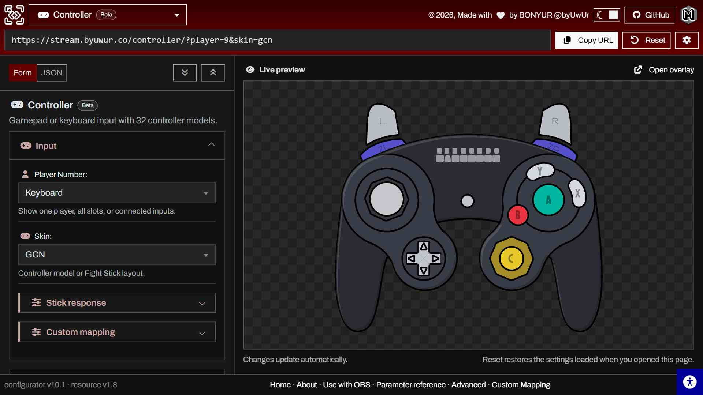
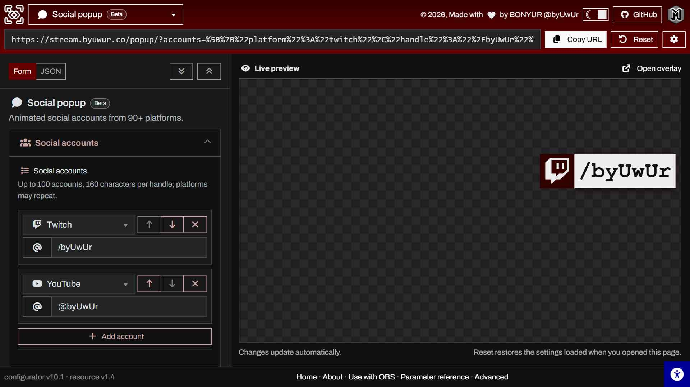
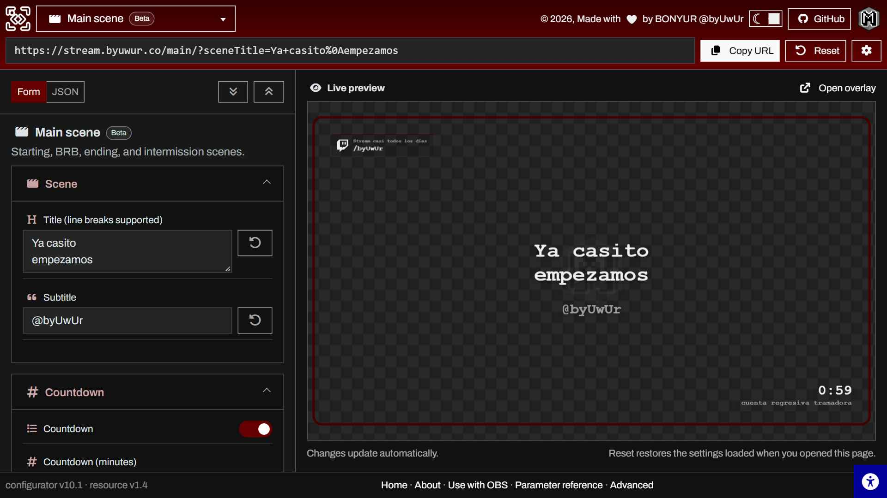

# byuwur/stream.html

Browser overlays for your stream. Configure a tool and copy its URL into OBS. Free. Forever. No account, install, or build step.

<!-- [Open stream.html](https://byuwur.github.io/stream.html/) · [Configurator demo](https://byuwur.github.io/stream.html/configurator.html) -->

[Open stream.html](https://stream.byuwur.co/) · [Configurator demo](https://stream.byuwur.co/configurator.html)

## Available overlays

All 23 overlays are available as prereleases. **Alpha** means early testing; **Beta** means broader testing. Features may change, and bugs are expected. Try your setup before going live. Status pills appear beside tool titles on the landing page, in the tool picker, and in the configurator heading.

<!--
| Tool                                                                       | Status | Purpose                                                                                | Local entry point         |
| -------------------------------------------------------------------------- | ------ | -------------------------------------------------------------------------------------- | ------------------------- |
| [Controller](https://byuwur.github.io/stream.html/controller/)             | Beta   | Gamepad/keyboard input with 32 controller models, compact layouts, and editable color. | `controller/index.html`   |
| [Social popup](https://byuwur.github.io/stream.html/popup/)                | Beta   | Animated accounts with 90+ platforms, fonts, colors, and timing.                       | `popup/index.html`        |
| [Main scene](https://byuwur.github.io/stream.html/main/)                   | Beta   | Starting/BRB/ending scenes with branding, countdown, accounts, and schedule.           | `main/index.html`         |
| [Clock](https://byuwur.github.io/stream.html/clock/)                       | Alpha  | Digital, analog, split-flap, and minimal clocks.                                       | `clock/index.html`        |
| [Timer / Countdown](https://byuwur.github.io/stream.html/timer/)           | Alpha  | Countdown or elapsed timer with an optional fixed start.                               | `timer/index.html`        |
| [Webcam Frame](https://byuwur.github.io/stream.html/webcam/)               | Alpha  | Transparent frame for your camera.                                                     | `webcam/index.html`       |
| [Ticker](https://byuwur.github.io/stream.html/ticker/)                     | Alpha  | Scrolling news, commands, and reminders.                                               | `ticker/index.html`       |
| [Watermark](https://byuwur.github.io/stream.html/watermark/)               | Alpha  | Text, monogram, or logo branding.                                                      | `watermark/index.html`    |
| [Lower Thirds](https://byuwur.github.io/stream.html/lower-thirds/)         | Alpha  | Broadcast cards for guests, games, and moments.                                        | `lower-thirds/index.html` |
| [QR / Link Card](https://byuwur.github.io/stream.html/qr/)                 | Alpha  | Locally generated QR code and link card.                                               | `qr/index.html`           |
| [Periodic Reminder](https://byuwur.github.io/stream.html/reminder/)        | Alpha  | Automatic reminders on your schedule.                                                  | `reminder/index.html`     |
| [Stream Badge](https://byuwur.github.io/stream.html/badge/)                | Alpha  | LIVE, AFK, recording, and custom labels.                                               | `badge/index.html`        |
| [Credits Roll](https://byuwur.github.io/stream.html/credits/)              | Alpha  | Closing credits for your community.                                                    | `credits/index.html`      |
| [Schedule](https://byuwur.github.io/stream.html/schedule/)                 | Alpha  | Dated run of show with current-segment highlighting.                                   | `schedule/index.html`     |
| [Sponsor Carousel](https://byuwur.github.io/stream.html/sponsors/)         | Alpha  | Rotating public logos and messages.                                                    | `sponsors/index.html`     |
| [Info Board](https://byuwur.github.io/stream.html/info/)                   | Alpha  | Rules, game settings, commands, and other stream details.                              | `info/index.html`         |
| [Screen Effects](https://byuwur.github.io/stream.html/effects/)            | Alpha  | Rain, snow, confetti, and floating symbols.                                            | `effects/index.html`      |
| [Camera HUD](https://byuwur.github.io/stream.html/hud/)                    | Alpha  | Recording indicator, timecode, and camera styling.                                     | `hud/index.html`          |
| [Progress Timeline](https://byuwur.github.io/stream.html/timeline/)        | Alpha  | Progress from a starting time to an ending time.                                       | `timeline/index.html`     |
| [Randomizer](https://byuwur.github.io/stream.html/randomizer/)             | Alpha  | Seeded draws for challenges, games, and choices.                                       | `randomizer/index.html`   |
| [Quote Display](https://byuwur.github.io/stream.html/quotes/)              | Alpha  | Rotating quotes, tips, and trivia.                                                     | `quotes/index.html`       |
| [Keyboard Shortcut Sheet](https://byuwur.github.io/stream.html/shortcuts/) | Alpha  | Editable shortcut guide without keyboard monitoring.                                   | `shortcuts/index.html`    |
-->

| Tool                                                           | Status | Purpose                                                                                | Local entry point         |
| -------------------------------------------------------------- | ------ | -------------------------------------------------------------------------------------- | ------------------------- |
| [Keyboard & Mouse](https://stream.byuwur.co/keyboard/)         | Alpha  | Live keyboard/mouse SVG input and optional ephemeral Input History.                    | `keyboard/index.html`     |
| [Controller](https://stream.byuwur.co/controller/)             | Beta   | Gamepad/keyboard input with 32 controller models, compact layouts, and editable color. | `controller/index.html`   |
| [Social popup](https://stream.byuwur.co/popup/)                | Beta   | Animated accounts with 90+ platforms, fonts, colors, and timing.                       | `popup/index.html`        |
| [Main scene](https://stream.byuwur.co/main/)                   | Beta   | Starting/BRB/ending scenes with branding, countdown, accounts, and schedule.           | `main/index.html`         |
| [Clock](https://stream.byuwur.co/clock/)                       | Alpha  | Digital, analog, split-flap, and minimal clocks.                                       | `clock/index.html`        |
| [Timer / Countdown](https://stream.byuwur.co/timer/)           | Alpha  | Countdown or elapsed timer with an optional fixed start.                               | `timer/index.html`        |
| [Webcam Frame](https://stream.byuwur.co/webcam/)               | Alpha  | Transparent frame for your camera.                                                     | `webcam/index.html`       |
| [Ticker](https://stream.byuwur.co/ticker/)                     | Alpha  | Scrolling news, commands, and reminders.                                               | `ticker/index.html`       |
| [Watermark](https://stream.byuwur.co/watermark/)               | Alpha  | Text, monogram, or logo branding.                                                      | `watermark/index.html`    |
| [Lower Thirds](https://stream.byuwur.co/lower-thirds/)         | Alpha  | Broadcast cards for guests, games, and moments.                                        | `lower-thirds/index.html` |
| [QR / Link Card](https://stream.byuwur.co/qr/)                 | Alpha  | Locally generated QR code and link card.                                               | `qr/index.html`           |
| [Periodic Reminder](https://stream.byuwur.co/reminder/)        | Alpha  | Automatic reminders on your schedule.                                                  | `reminder/index.html`     |
| [Stream Badge](https://stream.byuwur.co/badge/)                | Alpha  | LIVE, AFK, recording, and custom labels.                                               | `badge/index.html`        |
| [Credits Roll](https://stream.byuwur.co/credits/)              | Alpha  | Closing credits for your community.                                                    | `credits/index.html`      |
| [Schedule](https://stream.byuwur.co/schedule/)                 | Alpha  | Dated run of show with current-segment highlighting.                                   | `schedule/index.html`     |
| [Sponsor Carousel](https://stream.byuwur.co/sponsors/)         | Alpha  | Rotating public logos and messages.                                                    | `sponsors/index.html`     |
| [Info Board](https://stream.byuwur.co/info/)                   | Alpha  | Rules, game settings, commands, and other stream details.                              | `info/index.html`         |
| [Screen Effects](https://stream.byuwur.co/effects/)            | Alpha  | Rain, snow, confetti, and floating symbols.                                            | `effects/index.html`      |
| [Camera HUD](https://stream.byuwur.co/hud/)                    | Alpha  | Recording indicator, timecode, and camera styling.                                     | `hud/index.html`          |
| [Progress Timeline](https://stream.byuwur.co/timeline/)        | Alpha  | Progress from a starting time to an ending time.                                       | `timeline/index.html`     |
| [Randomizer](https://stream.byuwur.co/randomizer/)             | Alpha  | Seeded draws for challenges, games, and choices.                                       | `randomizer/index.html`   |
| [Quote Display](https://stream.byuwur.co/quotes/)              | Alpha  | Rotating quotes, tips, and trivia.                                                     | `quotes/index.html`       |
| [Keyboard Shortcut Sheet](https://stream.byuwur.co/shortcuts/) | Alpha  | Editable shortcut guide without keyboard monitoring.                                   | `shortcuts/index.html`    |

Open a tool, adjust its fields, check the preview, then **Copy URL** into an OBS **Browser** source with **Local file** unchecked. Use **1920 × 1080** for Main; size Controller/Popup to your layout.

Help improve stream.html on GitHub: [contribute a pull request](https://github.com/byuwur/stream.html/pulls) or [report an issue](https://github.com/byuwur/stream.html/issues). Bug reports, ideas, and fixes are welcome; see [Contributing](CONTRIBUTING.md).

## Settings stay in the URL

- Bare folder/`index.html` URLs open the editor; query settings without a hash render the overlay.
- Press **F2** to switch between the configurator and its current overlay, or append `#configure` to edit a link. In OBS, use **Interact** first. F2 is ignored in preview frames, with modifiers/repeats, and while typing in overlay controls.
- In the configurator, press **F1** to open **About**.
- Form edits and same-tool URL edits apply after a 250 ms pause via SPA.js's shared `debounce()`, updating the form and preview in place without adding browser history entries. **Enter** or leaving the changed URL field applies immediately; links to another tool navigate then.
- The sticky settings toolbar switches between **Form** and editable **JSON**. JSON uses field IDs and native values, showing mandatory overlay fields plus non-default settings; **Show all fields** includes every editable field, including defaults and conditional fields. Missing keys restore resource defaults; invalid JSON, unknown keys, and invalid values keep the last valid preview. JSON edits use the same 250 ms debounce. Both JSON views are prepared with accepted URL updates; switching views reuses that content. The JSON editor fills the remaining settings-panel space and adapts to viewport changes. **Copy** copies the displayed JSON. Form's **Expand All** / **Collapse All** icons control sections and subsections; their tooltips appear below the buttons. Accessibility tooltips open to the left.
- Editing keeps the browser address unchanged. **Copy URL** shares the current overlay settings. Bare tool URLs resume the saved configuration; explicit query settings take priority, including on reload.
- **Reset** restores the settings, list order, and compression choices from when the page opened, including after direct URL edits.
- **Advanced → Restore resource defaults** clears this resource's saved configuration and reloads the defaults declared in its JavaScript.
- Invalid form values keep the last valid preview and stop URL generation. Invalid/unknown URL values retain defaults. Clearing display text leaves it empty and hides its container; whitespace-only text also becomes empty. Clearing other resource fields restores their defaults. List editors retain their row editing and validation behavior.

Numeric fields with finite minimum/maximum values pair a slider with an exact number box. Both edit the same validated value; out-of-range text keeps the last valid preview. Select fields with up to three choices use keyboard-accessible segmented buttons. Imports, conditional controls, JSON, and Reset keep both widgets synchronized with their original field.

Generated links include only values that differ from the declared defaults, plus each resource's explicit `urlRequired` fields. Off/default appearance values are omitted, and missing parameters use resource defaults. Controller always includes `player` and `skin`; `customColors=no` is the default and is omitted from URLs and compact JSON. Popup includes `accounts`; Main includes `sceneTitle`. Imports use defaults for missing values; empty text stays empty and its text container is hidden. Cleared numbers and invalid zero values restore their field defaults when editing finishes; opening a bare editor still resumes saved preferences. Explicit empty arrays/maps such as `accounts=[]` remain valid ways to remove list content.

The form handles encoding and list add/edit/reorder/remove. Colors use 3/4/6/8 hex digits without `#`, including alpha: `fontColor=fff`, `backgroundColor=00000000`. Runtime restores `#`; older encoded hashes work. Invalid colors retain defaults; RGB/HSL/named colors are outside the contract.

Fonts include 350 Google families, system fonts, and installed families/CSS stacks. Fonts and visible samples load on demand; OBS needs access to the chosen font or uses the tool's fallback. Theme preference is local. Every resource has an **Animate** switch, On by default and independent of the system reduced-motion preference. Off disables resource motion while preserving content updates, timing, and gamepad input. The configurator keeps its own animations. Timer and Timeline bars and rings interpolate from the clock between text updates; this pauses while hidden and becomes immediate clock ticks with Animate Off.

All 23 resources keep transparent canvases. Resource defaults use the BONYUR palette: off-white `#eee`, charcoal `#111`, dark crimson `#600`/`#300`. Compact cards favor 40% charcoal surfaces, 12 px backdrop blur, 8-12 px padding, 6 px corners, and faint borders/shadows. Main retains its 6 px dark-crimson frame, inset 24 px, with transparent space inside and blur on its cards. Popup uses 40% charcoal and crimson surfaces and blurs its text box; Webcam blurs only its label so camera content stays clear. Text sizes keep labels and supporting copy close to their main value; Clock defaults to 32 px digits with 20 px labels/date. Clock starts as a single horizontal line; Timer, Timeline, QR, Schedule, and shortcut layouts favor compact rows. Main and Popup use the same palette, with ready-to-edit byUwUr content. Camera and effects canvases retain transparent content areas. Text uses `"Courier New", Courier, monospace`; the configurator uses Archivo. Explicit URL settings override the defaults, and the BONYUR appearance preset restores the card palette without replacing content or layout.

Backdrop blur samples content within the same browser page; it cannot blur other OBS sources underneath the Browser Source. Use background alpha for translucent surfaces; overall opacity below 100% can isolate the backdrop and suppress the blur.

Shadow and glow switches remain independent. Card shadows start On with 8% black and soft edges; glows remain Off. Turn either layer off or adjust its color, softness, and spread. Generated URLs omit whichever values match that resource's defaults.

Main offers countdown formats for hours/minutes/seconds, total minutes, total seconds, or unit labels. Formats change the display, not the countdown duration.

Timer, Timeline, Reminder, and timed Randomizer start when the overlay page loads. **Use fixed start time** (`useStartTime=yes`) is Off by default and reveals the start timestamp when enabled. Fixed anchors survive copied URLs and reloads; inactive timestamps are omitted. Timeline uses `duration` (seconds, default `3600`) on load, or its start/end timestamps with the switch On. Timer deadline mode still uses an absolute end time; Restart always starts on load. Existing links with a start timestamp need `useStartTime=yes` to retain their fixed schedule. Schedule activities keep their explicit calendar dates.

Media fields accept public HTTP(S) URLs or paths relative to the tool HTML. Local file URLs need downloaded use. Image fields also accept PNG, JPEG, WebP, and GIF Base64 data URIs. Keep private information out of shared URLs.

### Image inputs

Every image field, including card rows, has a URL input, provider selector, and **Browse** button. Drop an image anywhere on that component or browse for a file. PNG, JPEG/JPG, WebP, and GIF are supported; animated GIF bytes are preserved. SVG and video uploads are rejected. Main's background upload controls appear only in Image mode; video URLs keep their existing behavior.

- **Manual** accepts an existing URL, relative image path, or supported image data URI. Editing the text selects Manual, dismisses feedback, and cancels pending work. Browse/drop from Manual selects **Catbox.moe** after a file is chosen; canceling the picker changes nothing.
- **Catbox.moe** uploads the original file anonymously through the absolute endpoint `https://stream.byuwur.co/upload_image.php`, up to **8 MiB (8,388,608 bytes)** and **16 megapixels**. The editor checks the HTTPS image URL and loads it before applying it. Uploads are public; no account or key is needed. Network, HTTP, CORS, and invalid-response failures preserve the old value. The PHP host forwards directly to Catbox; no browser-to-Catbox request or automatic retry is made. A network failure may follow a completed upload. Check connectivity before deliberately trying again, or use Base64 for a small image.
- **GoFile** is temporarily disabled; it is absent from the selector and is never used as a fallback.
- **Base64** converts locally without uploading. The default limit is **16 KiB of original data**, including pasted data URIs. Larger files show `Image is too large to embed. Try Catbox instead.` Compression may help, but embedded images still produce long URLs; test the copied URL in your OBS build. Raw Base64, SVG, and video data URIs are unsupported.

Changing provider affects only the next Browse/drop; it never changes the existing image. Pending operations keep the current value. Feedback appears below its own field: progress lasts until completion, success dismisses after 5 seconds, and errors after 10 seconds. Manual edits, Reset, imports, and removed rows cancel stale operations and feedback. The provider never enters JSON, saved settings, or overlay URLs.

`byConfigurator.imageOptions.base64MaxBytes` may customize the local embedding limit before editor initialization (default `16384`); image values still have a 65,536-character safety bound and lists a 1 MiB bound. Hosted uploads always use the absolute PHP endpoint and its fixed 8 MiB limit. Ordinary remote image loading does not require CORS-enabled pixel access. See the [Catbox API](https://catbox.moe/tools.php) for the upstream contract.

### Hosted upload deployment

`upload_image.php` is standalone; it does not load SPA.php or require accounts, cookies, or API keys. It accepts multipart POST `fileToUpload` and an optional `provider` ID. The frontend sends `provider=catbox`; PHP owns the upstream endpoint and multipart operation. It validates uploaded-file origin, actual byte size, Fileinfo MIME, dimensions, and a bounded GD decode, then forwards the original file with `CURLFile`. Extensions/client MIME do not establish trust. PNG/JPEG/WebP/GIF (including animated GIFs) are supported; SVG uploads are disabled. Decoder memory is bounded to 16 megapixels and the server's available memory.

Provider selection uses the request's `provider`, then the server environment variable `STREAM_UPLOAD_PROVIDER`, then `IMAGE_UPLOAD_DEFAULT_PROVIDER` (`catbox`). `image_upload_provider()` maps allowed IDs to hardcoded endpoints, file fields, fixed form fields, and response parsers. Add a `match` case and a parser returning an approved HTTPS image URL or `null` for each new host. Unknown/malformed request providers return 400 without contacting an upstream; an unavailable server default returns 503. Client-supplied endpoint URLs and operation names are ignored. Catbox is the only enabled provider; adding another to the UI also requires its selector/upload adapter and response URL validation.

Deploy only the root `upload_image.php` to the Hostinger document root for **https://stream.byuwur.co/upload_image.php**. GitHub Pages and downloaded configurators use that same absolute HTTPS endpoint. PHP is excluded from the HTML/Controller ZIP distributions; it is never needed for normal overlay rendering.

1. Enable **PHP 8.2+**, **cURL**, **Fileinfo**, and **GD with PNG/JPEG/WebP/GIF support**. Use the system CA trust store; keep TLS verification enabled and allow outbound HTTPS to `catbox.moe:443`.
2. In Hostinger's PHP settings use `file_uploads=On`, `upload_max_filesize=8M`, `post_max_size=10M` or higher, `max_execution_time=60` or higher, `memory_limit=256M`, `display_errors=Off`, and `log_errors=On`. Disable displayed startup errors too; PHP can reject a request before this script executes. Ensure `upload_tmp_dir` exists and is writable by PHP. The application cannot raise PHP/web-server/proxy request limits; configure those separately to admit an 8 MiB file plus multipart overhead.
3. The limiter defaults to a private `stream-image-<installation hash>` directory under PHP's system temporary directory. It creates the directory with mode `0700` and its locked file with `0600`. If Hostinger's `open_basedir` restricts temporary storage, precreate a private directory **outside the public document root**, owned/writable only by the PHP user, and set the server environment variable `STREAM_UPLOAD_RATE_DIR` to its absolute path. Allow this path in `open_basedir`. Never place it in a downloadable folder. Storage failure/corruption rejects uploads with 503; it never disables limiting.
4. Verify HTTPS and `OPTIONS` (204), a small supported image POST, invalid-file errors, and server logs after deployment. Frontend tests mock the service; local success does not establish production deployment or a successful live Catbox upload.

The limiter allows **10 POST attempts per client address per 10 minutes**, including invalid attempts. It trusts only `REMOTE_ADDR`; arbitrary forwarded headers cannot evade it. Shared proxies/NAT share a limit. The lock serializes updates, expired entries are removed, and active clients are capped at 4096. A 429 response includes `Retry-After`. Wildcard credential-free CORS supports production, GitHub Pages, localhost, `file://`, and independent copies, including error responses and preflight; CORS is not abuse protection.

The shared upstream transport uses verified TLS, a 10-second connection timeout, a 40-second request timeout, no redirects, and no automatic replay. Only HTTPS raster URLs on `files.catbox.moe` are returned; upstream HTML, raw transport diagnostics, and paths never enter public errors. Logs record safe failure categories/status codes. Uploads are public and anonymous; keep private images out of them. For 413, check both server and application limits; for 429 wait; for 503 check extensions/private storage; for 502/504 check outbound connectivity and Catbox availability. A successful upload whose image subsequently cannot load keeps the previous field value, though the public upload may already exist.

### Keyboard shortcuts

About includes the shortcut reference. Focus the configurator to use these:

| Shortcut            | Action                                          |
| ------------------- | ----------------------------------------------- |
| `F1`                | Open About.                                     |
| `F2`                | Switch between configurator and overlay.        |
| `Alt+Shift+P`       | Open Parameters.                                |
| `Alt+Shift+A`       | Open Advanced options.                          |
| `Alt+Shift+O`       | Open the current overlay in a new tab.          |
| `Alt+Shift+C`       | Copy the overlay URL.                           |
| `Alt+Shift+U`       | Focus and select the overlay URL.               |
| `Alt+Shift+M`       | Open the tool picker.                           |
| `Esc`               | Close the current dialog, popover, or dropdown. |
| `Tab` / `Shift+Tab` | Move between controls.                          |

`F2` switches modes when the editor is included and is ignored inside previews. Renderer-only copies show a warning with links to the official hosted editor and repository for F2 or `#configure`; they never load editor dependencies. F3/F4 retain browser actions. Modified or repeated function keys, repeated shortcuts, and IME composition are ignored.

### Shorter URLs

Open **Advanced** from the toolbar gear or footer. Compression is raw DEFLATE plus unpadded Base64url; the panel shows length/savings and keeps the readable URL when shorter.

Form values, expanded sections, and Advanced options are remembered per resource. Only valid form values are saved, using the generated query's chosen compression format and readable fallback. Small configurations use a one-year cookie scoped to the resource folder; larger configurations, blocked cookies, and `file://` copies use local storage. Explicit URL settings and compression formats take priority. Overlays use their URL only; invalid or unavailable storage leaves editing usable.

| Mode            | URL representation                                                                                                  |
| --------------- | ------------------------------------------------------------------------------------------------------------------- |
| All settings    | `?data=<compressed ordinary query string>`; readable parameters alongside it override packed values.                |
| Selected fields | `?accounts=dr:<token>&mode=left`; checked fields compress independently and keep their names. Others stay editable. |

Plain values need no marker. Escape literal text starting with `dr:` or `raw:` as `raw:<original text>`; generated links do this automatically. `#configure` restores compression choices. Invalid compressed fields retain defaults without discarding valid neighbors; Advanced shows a warning.

Whole-query decoding is capped at one MiB. Individual values use the field's UTF-8 text limit, allowing up to four bytes per character, capped at one MiB. Images may also use the bounded Base64 data URIs described above.

Each tool declares [SPA.js `_functions.min.js`](https://cdn.jsdelivr.net/gh/byuwur/spa.js@latest/_functions.min.js) in its shared asset group before `resource.js`. For offline use, save the helper and update its import path. These helpers need no jQuery/SPA initialization. Browsers without native raw-DEFLATE support can use readable links.

### Downloaded use

Keep the tool folder plus parent `resource.js` and its renderer dependencies. Keep `configurator.js`/`configurator.css` when editing is needed; overlays still work when the configurator script or the whole configurator markup/dependency section is removed. A single HTML file is not a bundle. Controller requires HTTP/HTTPS to load its editable SVG resources; the local-file instructions below apply to the other overlays. Open `{tool}/index.html` and paste its generated `file:///.../index.html?...` URL into OBS with **Local file** unchecked. Keep those paths stable. Hosted links use tool directories.

The landing page starts its CSS batch with `defer: false` during head parsing and declares JavaScript with ordered `<script src defer>` tags. `resource.js` owns `byStream.SPA_VERSION = "v20.12"`, overriding each asset group's `data-spa-version` fallback. External JSON asset groups declare their repository URL in `data-source`. Resource pages declare shared helpers/fonts in `#shared-assets`, renderer-only libraries in `#resource-assets`, and editor groups in `script[data-load]` inside `#configurator-assets`. Local editor styles and scripts use explicit `<link>` and `<script src defer>` tags together after the external import group, so local overrides follow SPA assets. SPA.js `_load.min.js` loads these CSS/JS arrays into the head in dependency order; `byStream.assetsReady` resolves before resource initialization. Renderer-only libraries load only in overlay mode; configurators and renderers both load the shared imports. Editor setup runs only in configure mode; renderer application code uses vanilla JavaScript. Main/Popup also use GSAP and Popup uses MorphSVG. Font-enabled pages use native `byFont`. Offline use requires saved CDN dependencies and updated `src`/`href` paths.

### Older URLs

Replace `controller.html`, `popup.html`, or `main.html` with its tool folder. Rebuild retired settings in the form: Controller `scale`; Popup `fontSizeRem`/`textYOffsetRem` (now `fontSize`/`textYOffset` in pixels), per-platform handles/account counts; Main scene `mode`, `showBG`, `hideCountdown`, and weekday fields.

Current URLs use percentages for opacity, deadzone, and scale: `100` means 100%, and `25` means 25%. Replace older fractional values explicitly; they are not converted. Social accounts use ordered rows so platforms may repeat; Main schedule entries use weekday maps. Unsupported list shapes retain defaults rather than being migrated. The form and Parameters dialog show the current fields and accepted values.

## Keyboard & Mouse

[Configure Keyboard & Mouse](https://stream.byuwur.co/keyboard/) · [WASD overlay](https://stream.byuwur.co/keyboard/?mode=both&layout=fps)

The interactive `keyboard/` resource shows real physical key and mouse transitions. The existing **Keyboard Shortcut Sheet** remains a static, editable guide without input monitoring. Both use the ordinary shared configurator, URL/JSON editors, Copy URL, Reset, resource defaults, F2, Animate, and transparent canvas.

Choose **Keyboard only**, **Mouse only**, **Keyboard + Mouse**, or **Hidden** for history-only configurations. Keyboard and mouse have independent offsets/scales; choose a side-by-side or stacked composition, viewport fit, overall placement, and opacity. Mouse colors follow the keyboard palette unless independent mouse colors are enabled.

Layouts include full-size, TKL, 75%, 65%, 60%, compact letter rows, numpad, function row, arrows, WASD, WASD + modifiers, and All physical keys. Windows/macOS labels, ANSI/ISO geometry, and QWERTY/QWERTZ/AZERTY legends have separate selectors. Gaming examples include FPS, MOBA, League of Legends, Dota 2, MMO/RPG, racing, fighting, platformer, rhythm, speedrunning, and custom compact. They filter the real keyboard's positions, staggering, and modifier/spacebar widths rather than packing controls into artificial rows. All physical keys preserves the full-size geometry and adds extension rows for international slots and F13-F24. Gaming bindings are configurable examples, not official game bindings. There is no OS/layout autodetection. Some international/Fn/system keys depend on browser and hardware exposure. Physical slots use keyboard units, including the [documented ISO Enter bounds](https://docs.qmk.fm/reference_info_json).

Use **Selected physical keys** to choose predefined physical codes such as `KeyW`, `Space`, `ShiftLeft`, or `ArrowUp` from dropdowns, with row actions on the right; an empty list shows every preset slot. Group switches hide letters, modifiers, navigation, and other groups. **Key labels** and **Action descriptions** customize existing slots, with optional visible actions. Geometry stays preset-based; there is no per-key drag editor.

Hollow Kenney SVG contours supply surfaces, outlines, and recognizable vector legends. Nine coordinated palettes and custom shell, keycap, outline, legend, press, highlight, and shadow colors are available. Shell choices include complete, minimal, floating, outline, and gaming; keycaps can be filled or outlined. Presses update mounted SVG controls immediately, with inversion, fill, depth, or glow and a smooth release. Animate Off removes motion while retaining input feedback.

Artwork uses short names such as `a.svg`, `ctrl.svg`, and `scrollup.svg`. Primary files contain the hollow artwork; `-fill.svg` retains the corresponding filled originals. Renaming preserves the original SVG bytes.

**Image backgrounds** accepts shell and keycap images independently through the shared image URL/upload controls. Images are clipped to the vector surfaces; Cover, Contain, Stretch, scale, opacity, texture tint, monochrome tint, and green-region replacement are available. Original vector colors remain underneath failed images. Outlines and labels stay readable and pressed fills stay visible. Safe image formats follow the shared image contract; animated images remain mounted during input updates.

The mouse uses one Kenney composition with separate left/right/middle and side buttons, brief wheel direction highlights, and a movement indicator. Ordinary movement never creates history entries.

**Browser input limitation:** keyboard/mouse events arrive only while this browser context can receive them. A Browser Source cannot monitor a game or another unfocused application. In OBS, add the configured URL as a Browser Source with Local file unchecked, set its dimensions (for example 1280 × 720), open **Interact**, and focus the overlay to receive events. Preview capture likewise needs focus inside the preview. Editor fields, password fields, and editable content are excluded; F2 keeps its normal navigation behavior. No native OBS Helper, global hooks, or background-capture workaround is included. Keyboard SVG loading requires HTTP/HTTPS, including local development; direct `file://` cannot fetch the artwork.

## Input History

Keyboard & Mouse and Controller share optional **Input History**, Off by default. Controller's existing URLs and default appearance are unchanged. Choose SVG prompts or plain text, vertical/horizontal flow, newest first/last, independent position/scale/dimensions, spacing, padding, opacity, colors, and slide/fade/no animation.

Width and height default to `0` (automatic). Horizontal history is one prompt high plus entry/container padding and uses the available parent width. Vertical history is one prompt wide plus padding and uses the available parent height; combinations stack within that narrow column. Positive dimensions override automatic sizing. Each zero dimension exposes **Fill parent** below it. The visualization fits into the space outside history, including after viewport changes.

Nearby simultaneous presses form combinations (default 60 ms). Held modifiers join subsequent actions, keyboard auto-repeat is ignored, and consecutive discrete repetitions aggregate as `E ×3`. A different input starts a new sequence. Held controls produce one transition. Entries remain until displaced; capacity comes from the actual container dimensions, with old DOM nodes and row data removed on overflow or resizing. There is no fixed maximum-entry setting or expiry timer.

Keyboard history can include keyboard, mouse, or both independently of the visible mode. **All received inputs** includes eligible physical keys outside compact presets; **Displayed controls only** includes only mounted controls. Controller history uses selected players and their existing mapped polling pipeline, including keyboard-as-controller, buttons, triggers, model-specific digital inputs, and optional discrete stick directions. It does not add another polling loop or keyboard listener.

Input History is ephemeral. Recorded inputs are never stored in browser storage, cookies, files, configuration URLs, or requests. Only configuration choices use the configurator's existing persistence. Labels come from physical IDs and predefined/configured labels, never recorded typed text. Focus loss clears live held state; teardown releases listeners, timers, observers, and displayed history.

## Controller

<!-- [Example: Player 1, Xbox One](https://byuwur.github.io/stream.html/controller/?player=1&skin=xone) -->

[Example: Player 1, Xbox One](https://stream.byuwur.co/controller/?player=1&skin=xone)

| Parameter | Meaning |
| --- | --- |
| `player` | Gamepads `1`-`8` (default `1`); keyboard `9`; `all-gamepads` always shows P1-P8 and `all-inputs` adds keyboard. `gamepads` and `all` show only connected inputs without/with keyboard. |
| `skin` | `xseries` Xbox Series (default), `ds5` DualSense, `fgc` Fight Stick (8 buttons), `fgc6` (6 buttons), `fgc4` (4 buttons), `xone` Xbox One, `ds4` DualShock 4, `x360` Xbox 360, `ds3` DualShock 3, `gcn` GameCube, `n64` Nintendo 64, `snes` SNES, `nes` NES. |
| `showPlayerIndicators` | `no` (default) hides player lamps, including Xbox 360 guide segments; `yes` shows them. |
| `layout`, `buttonLabels` | `full` (default) or `minimal`; `icons` (default), `letters`, or `none`. |
| `variant` | A palette supported by that model, such as PS2 `silver` or `white`; Default (`original`) uses its SVG base palette. The picker lists only that skin's variants. Changing Skin preserves Default and Sequential (all); a named palette resets to Default. Sequential (all) (`sequential`) cycles Default and the available palettes across visible controllers, repeating as needed; a single controller uses Default. Available while Custom colors is Off. |
| `customColors` | Default `no` preserves the SVG shell/control palette. `yes` enables custom shell color and optional control tint. Vector details and Guide button are independent. |
| `tintControls` | Optional button-plastic tint derived from `controllerColor`; default `no` preserves hardware colors. Rubber sticks and shoulders stay unchanged. |
| `disconnectedTint`, `disconnectedOpacity` | Disconnected tint (alpha controls strength; transparent disables it) and opacity `0` to `100`% (default `5`). Connected appearance is unchanged. |
| `controllerColor` | Custom body color, initially `000000`. Colors the body with `customColors=yes`; flat panel/socket tones follow it. Also supplies the automatic outline tint when enabled independently. |
| `tintOutlines`, `customOutlineColor`, `outlineColor` | Both switches default to `no`, retaining native stroke colors. Automatic tint derives darker outlines from the shell and takes precedence over an enabled manual color. |
| `outlineWidth` | Multiplies each structural stroke's original width; `0.5`-`2`, default `1`. Hardware lettering, fine details, and composite filled borders retain their proportions. |
| `highlightIntensity`, `shadowIntensity` | Independent vector shading intensity, `0`-`100`%; defaults `12` and `16`. |
| `customGuide`, `guideSource` | Eligible system/home buttons retain their original symbol by default. Enable `customGuide=yes` to choose `symbol` or `image`. Replacements paint above the shell, with a button face covering the original emblem's cutout. |
| `guideSymbol`, `guideImage` | Original hardware, Xbox, PlayStation, Steam, circle, diamond, or star; alternatively a safe HTTP(S)/relative PNG, JPEG, WebP, SVG, or animated GIF image URL. Failed images restore the original emblem. |
| `guideColorMode`, `guideColor` | `original` preserves symbol/image colors. `custom` recolors symbols or applies an alpha-preserving monochrome image tint. |
| `guideScale`, `guideOffsetX`, `guideOffsetY` | Scale `50`-`150`% (default `100`), offsets `-25`-`25`% (default `0`). Content preserves aspect ratio and is clipped within the replacement button area. |
| `screenOpacity` | Display interior opacity, `0`-`100`%; default `0` creates an alpha opening while retaining the bezel. |
| `opacity` | `0`-`100`%; default `100`. |
| `offset`, `deadzone` | Stick travel in source pixels, scaled for the fighting stick and compact layouts; deadzone `0`-`100`% (default `5`). |
| `strength`, `curve` | `strength=1` uses proportional trigger filling (default); `strength=0` uses a digital state; `curve=1` enables stick curving. |
| `rotation` | Maximum steering-wheel rotation in degrees. |
| `mapping` | Custom Mapping binding array; `[]` uses defaults. Legacy `{"mapping":[...]}` works. |
| `mirror`, `fitMargin` | Mirror artwork horizontally; viewport fit margin in pixels (default `16`). |
| `horizontalPosition`, `verticalPosition` | Signed pixel offsets from the viewport center; both default to `0`. |

The selector groups 34 skin choices by platform from 32 front-facing SVG models. Existing named skin IDs remain valid. Fight Stick offers 8-, 6-, and 4-button choices (`fgc`, `fgc6`, `fgc4`) from source-authored views in one `fgc.svg`; the reduced layouts retain their original button positions and bindings.

- Nintendo: `nes`, `famicom`, `snes`, `superfamicom`, `n64`, `gcn`, `wii`, `wiinunchuk`, `wiiclassic`, `wiiupro`, `wiiu`, `joycon`, `switchpro`.
- PlayStation: `ps`, `ds2`, `ds3`, `ds4`, `ds5`.
- Xbox: `xbox`, `x360`, `xone`, `xseries`.
- Sega: `mastersystem`, `genesis`, `saturn`, `dreamcast`.
- Steam: `steam` (2015), `steam2` (2026), `steamdeck`.
- Other: `turbografx`, `playdate`, `fgc`, `fgc6`, `fgc4`.

Up to eight gamepads have independent player slots P1-P8; keyboard remains P9 and is excluded from the gamepad count. Existing browser indices 0-7 keep their corresponding player when available; other indices take a free slot. Connected players keep their assignments when another device disconnects. `player=all-gamepads` (All) always shows P1-P8; `player=all-inputs` (All + Keyboard) adds P9. Disconnected slots retain their configured tint and opacity. `player=gamepads` (All connected) shows connected gamepads only; `player=all` (All connected + Keyboard) includes keyboard. All multi-player modes use a responsive grid. Native player lamps keep their geometry and positions. Full layouts use smaller, closely spaced dark squares with a thin black outline and a green glow, placed clear of logos; Joy-Con lamps run vertically between the controllers. Minimal rows retain their existing size and position. Xbox 360 uses its guide ring in full mode and adds the shared row in minimal mode. In full and minimal layouts: P1-P4 light their corresponding lamp, P5 `X--X`, P6 `-X-X`, P7 `--XX`, P8 `X-XX`, and keyboard `XXXX`.

Each model owns one `controller/controllers/<id>.svg`; Fight Stick variants share `fgc.svg`. SVG attributes declare its name, platform, logical inputs, analog behavior, native bounds, and compact transforms. `data-player-leds` stores the full-layout x, y, scale, and optional rotation; minimal rows keep the shared renderer position. Shared JavaScript moves the same control nodes between layouts. Each compact layout has fitted bounds and a controller-specific composition; shoulders and triggers occupy aligned sections with long horizontal pill bars where requested. Full mode retains each model's hardware shapes, with mirrored shoulders and matching trigger contours. Stick housings and recessed sockets stay stationary around the moving caps. Minimal controls retain their native proportions; alternate wide bars are authored in the SVG rather than stretched from full-mode artwork. Dark stick caps use a lighter gray to make their movement clear against the recessed sockets. The renderer retains separate SVG roots per control for WebKit filter painting. Each SVG embeds its default appearance and renders independently. Its geometry and painting order remain authoritative; `controller.css` handles the application layers and pressed states. Native SVG groups provide the compact shoulder bars; no controller metadata files or duplicate SVG drawings are used.

All 39 purchased originals are preserved in [`_art/controller-illustrations/`](_art/controller-illustrations/). Nine perspective illustrations are reference-only: `360-A`, `ONEX-A`, `PS4-A`, `PS5-A`, `STEAM2-A`, `SWITCH-A`, `SWITCH-B`, `SWITCHPRO-A`, and `SX-A`. Steam Deck and Wii U artwork is rotated into its normal horizontal orientation. The Nunchuk front is reconstructed from the supplied angled reference; rear controls use visible indicators.

The integration SVGs contain their stock colors and model-specific palette variants. The coordinated palettes are BONYUR (`bonyur`), Arctic (`arctic`), Sakura (`sakura`), Lagoon (`lagoon`), Forest (`forest`), Sunset (`sunset`), Royal (`royal`), Sandstone (`sandstone`), and Cyberpunk (`cyberpunk`). These style shells, panels, and buttons. Fight Stick's three layouts already use BONYUR as Default and offer the other eight palettes on their controls. Every skin has at least nine palettes including Default; existing stock variants remain available. PlayStation, Xbox, Dreamcast, Steam, and Fight Stick themes use matching face-button fills; Genesis and Saturn keep A/B/C together. Xbox theme labels use contrasting light colors. Custom colors starts Off; its disabled drafts remain in the existing editor preferences, including after reopening, while shared URLs omit inactive options. Legacy links with an explicit controller color enable customization unless `customColors=no` is present. Older absolute outline widths are converted to the bounded relative scale.

With Custom colors enabled, `controllerColor` changes the shell with flat panel, socket, highlight, and shadow regions. Fixed hardware colors remain intact unless `tintControls=yes`. `buttonLabels=icons|letters|none` selects hardware markings, letters, or hidden markings; directional details and system emblems remain identifiable. Digital presses invert independently. Analog triggers retain their inactive base and outline while a contrasting fill grows bottom-to-top, or left-to-right in compact mode. `strength=0` keeps the saved disabled-pressure setting and displays a digital press. Steam Deck, Wii U, Dreamcast VMU, and Playdate screen interiors support true alpha with `screenOpacity=0`.

Shell texture uses **Solid color** (default), **Image**, or **Image + tint** under Appearance. Shell image uses the same Manual/Catbox/Base64 input as other image fields. Existing controller links keep their solid appearance. Textures fill only the SVG's authored shell plastics, including separate panels; original outlines, buttons, sticks, touchpads, labels, highlights, shadows, screen transparency, and input animation remain independent. Each model supplies its own geometry; Fight Stick layouts have no shell artwork and expose no texture controls. Minimal layouts hide the shell and its texture. Multiple players have independent SVG definitions.

| Shell parameter                               | Meaning                                                                                                                                                                      |
| --------------------------------------------- | ---------------------------------------------------------------------------------------------------------------------------------------------------------------------------- |
| `shellAppearance`, `shellImage`               | `solid` (default), `image`, or `tint`; URL, relative image path, or supported raster data URI. Failed loads and a 30-second loading timeout retain the original solid shell. |
| `shellFit`                                    | `cover` (default), `contain`, or `stretch`. Contain and transparent images reveal the configured solid shell beneath.                                                        |
| `shellPositionX`, `shellPositionY`            | Offsets as percentages of the model's shell bounds, `-100` to `100`; default `0` centers the image.                                                                          |
| `shellScale`, `shellRotation`, `shellOpacity` | Zoom `10`-`500`% (default `100`), rotation `-180` to `180` degrees (default `0`), opacity `0`-`100`% (default `100`). Transforms remain inside the shell.                    |
| `shellTintColor`, `shellTintStrength`         | Independent tint color (default white) and strength `0`-`100`% (default `0`, unchanged image). Available in Image + tint.                                                    |
| `shellBlendMode`                              | `multiply` (default), `overlay`, `soft-light`, or `color`; unsupported modes fall back to Multiply. Tint composition uses only the image, preserving source alpha.           |

**Reset image adjustments** restores fit, placement, opacity, and tint defaults while retaining the image and appearance mode. The ordinary Reset restores the opening configuration. Hidden image controls retain their drafts and are omitted from URLs. Uploaded bytes are never changed for tinting. Ordinary overlay rendering uses the final image URL directly and never calls PHP. Chromium pixel tests cover clipping, transforms, tint, transparency, and multiple instances; actual OBS Browser Source rendering and endurance still require verification in your OBS build.

Guide customization replaces the emblem inside an existing SVG slot without changing its binding or housing. SVG image URLs load as images rather than injected markup. Animated GIFs stay mounted through input frames and direct layout switching; Chromium tests verify changing rendered frames. Verify playback in your OBS build separately.

The [Steam hardware specifications](https://www.steamdeck.com/en/tech), [Nintendo Nunchuk controls](https://www.nintendo.co.jp/hardware/wiiu/accessories/nunchuk/index.html), and [GamePad Viewer](https://gamepadviewer.com/) were used as hardware/interaction references. Trackpad clicks can be assigned through Custom Mapping. Rear grips, final-click indicators, rails, volume, and crank activation are omitted from the visual controls; existing saved mappings retain their logical output indices. Browser Gamepad API exposure depends on the device/adapter; touch coordinates, motion, and native crank-angle tracking are not implemented.

Controller requires HTTP/HTTPS because browsers block fetching editable SVG resources from `file://`. No build step is needed. Tests in `__tests__/resources.cjs` cover control isolation, palettes, trigger pressure, alpha openings, layout reuse, and rendered-pixel inversion in Chromium, Firefox, and WebKit. Unavailable engines are explicitly skipped locally and fail in CI; WebKit testing does not establish OBS or Safari behavior on Apple hardware.

Choose **Keyboard** for automatic keyboard input; **F** also connects the keyboard for input detection. **Custom Mapping** shows connected devices, model-specific outputs, and recording controls. Add a binding, choose the output, select **Record input**, press the input, then **Apply mapping**. Keyboard capture accepts any identified key (`choiceType: "keys"` with its physical `KeyboardEvent.code`); older button/axis keyboard bindings still work. Escape or **Cancel recording** cancels the capture. Incomplete or duplicate bindings keep the applied mapping unchanged. Clear the binding draft and apply to restore standard input; Reset restores the opening configuration. Axis ranges and packed D-pad hats remain available for unusual adapters. DualSense microphone mute has its own output (`22`); bind it through Custom Mapping when an adapter exposes that input at a different raw index. N64 C buttons use the right stick on standard pads, with custom mapping targets 18-21 for dedicated C buttons. Skins fit the viewport automatically. Appearance controls retain background, opacity, scale, tilt, offsets, and artwork filters.

## Social popup

Choose platforms, handles, and order. Repeated platforms are allowed. Brand icons use a globe fallback.

| Parameter | Meaning |
| --- | --- |
| `mode` | `right` (default) or `left`. |
| `accounts` | Ordered rows, e.g. `[{"platform":"twitch","handle":"/byUwUr"},{"platform":"twitch","handle":"/byUwUr_es"}]`; up to 100 accounts, 160 characters/handle, 20,000 JSON characters. `[]` hides it. |
| `pauseTime`, `inbetweenPauseTime` | Seconds/account and between cycles: `0`-`3600`, default `3` each. |
| `animationSpeed` | Playback speed `0`-`500`%; `100` is normal and `0` pauses animation. |
| `scale` | `-500`-`500`%, anchored to the selected top corner; `100` keeps the original size. |
| `iconBoxColor`, `textBoxColor`, `iconColor`, `fontColor` | Hex colors without `#`; defaults use deep red `#600`, off-white `#eee`, and translucent charcoal. |
| `primaryFont`, `fontWeight` | Font family and weight `100`-`900`, step `100` (default `600`); Courier/monospace fallback. |
| `fontSize`, `textYOffset` | Size `8`-`100` px (default `48`); offset `-100`-`100` px. |
| `opacity`, `cornerInset`, `textPadding` | Optional opacity `0`-`100`%, signed corner inset on both axes, and horizontal text padding in pixels. |

Invalid JSON/platforms retain the two byUwUr default accounts; blank handles keep their slots. Font readiness and remeasurement keep animation aligned. Separate account-name and icon typography, text-box borders/shadows, placement, and filters are available in the form.

## Main scene

<!-- [Example: Starting soon](https://byuwur.github.io/stream.html/main/?sceneTitle=Starting+soon&tagline=Your+channel&countdownTime=5&displayBranding=no&displaySocial=no) -->

[Example: Starting soon](https://stream.byuwur.co/main/?sceneTitle=Starting+soon&tagline=Your+channel&countdownTime=5&displayBranding=no&displaySocial=no)

| Parameter | Meaning |
| --- | --- |
| `sceneTitle`, `tagline` | Multiline title up to 300 characters; subtitle up to 160. |
| `countdownTime`, `countdownMessage`, `countdownOverMessage` | Minutes `0`-`1440` (default `4`); during/after messages. |
| `countdownFormat` | `stopwatch` (total minutes/seconds, default), `clock`, `hours`, `units`, or total `seconds`. |
| `displayCountdown`, `displayBranding`, `displaySocial`, `displaySchedule`, `displayLabels` | `yes`/`no` toggles. Branding hides only the logo. |
| `primaryFont`, `titleSize`, `subtitleSize` | Font family and sizes `8`-`200` px; Courier/monospace fallback. |
| `primaryTextColor`, `subTextColor`, `accentColor`, `frameColor`, `contentBackgrounds`, `backgroundColor` | Hex without `#`; background defaults to transparent `00000000`, accent and frame to dark crimson `440000` at 8 px. |
| `frameWidth`, `frameInset` | Border thickness `0`-`100` px (default `6`); optional signed inset in pixels. |
| `logoUrl`, `logoOpacity`, `logoScale` | Image URL/path (default `https://byuwur.github.io/img/logo.png`), opacity `0`-`100`% (default `4`), scale `-500`-`500`% (default `100`). |
| `displayBackground`, `backgroundType`, `backgroundUrl`, `backgroundScale` | Media toggle (Off by default), `image`/`video`, media URL/path, and scale `-500`-`500`%. Enable the toggle to show media; the default URL is the BONYUR logo. |
| `backgroundBlur`, `backgroundOverlayOpacity`, `backgroundOverlay` | Blur `0`-`100` px, tint opacity `0`-`100`%, tint color. |
| `accounts` | Ordered rows with `platform`, `handle`, and `heading`; platforms may repeat. Up to 100 rows, 160 characters per text field, 20,000 JSON characters. Blank handles/`[]` hide accounts. |
| `scheduleEntries` | Weekday-to-text map, e.g. `{"monday":"Activity"}`; up to seven days, 160 characters/text, 4,000 JSON characters. `{}` hides it. |
| `animationSpeed` | Social animation speed `0`-`500`%; `100` is normal and `0` pauses animation. |

Invalid lists retain defaults. Individual controls cover title/subtitle, countdown and completion text, social names/icons, schedule text, event headings, card surfaces, and scene filters. Each visible section has its own positioning or scale controls where applicable. Follower/donation/subscriber labels are editable text, without live service updates.

## Development

Native overlay setup and shared helpers belong in `resource.js`, exposed as `byStream`. Its JSDoc defines `ResourceField`, `ResourceFields`, `ResourceSettings`, and `ResourceDefinition`, with detailed contracts for reusable utilities and non-obvious behavior. Resources declare their fields and defaults, then use those helpers. Tool definitions/rendering and CSS live in `{tool}/{tool}.js` and `.css`. The optional `configurator.js` owns the editor, preferences, help, preview, and tool catalog; `configurator.css` owns editor styling. Resources declare Animate.css alongside their editor stylesheet imports; those styles activate only in configure mode. Editor motion timing is controlled by `--settings-motion-duration` and `--settings-collapse-duration` in `configurator.css`. Rotating cards use `contentTransition()` for exit, container resizing, and entry; incoming content stays hidden until it fits, and newer updates cancel stale transitions. Sections and subsections reuse Bootstrap Collapse; subsections use full borders, accented left edges, shaded headers, and compact header padding. Revealed fields combine an Animate.css fade with an 8 px horizontal entry. Panels, fields, lists, feedback, accessibility menus, and Select2 dropdowns share a short slide/fade from the left. Departing content is immediately inert and hidden after their exit; rapid switches supersede earlier effects. Help tabs exit before the next page enters, and open containers interpolate height changes. Bootstrap retains height ownership during collapse transitions. Tooltips retain the shared instant behavior; controls transition their hover, focus, and toggle colors. Switches use the same thicker Bootstrap size. Select2 highlights enter from the left and leave to the right for pointer and keyboard navigation on the landing and in the configurator. These finite effects remain enabled with reduced motion; shared controls retain their own transition rules. Keep custom CSS for theme and widget/layout integration. `configurator.html` is the starter, and the root `index.html` renders the catalog.

Host interfaces can reuse the SPA-provided jQuery, Select2, `byCommon` (`_common.min.js`), and `byTransition` (`_transitions.min.js`) APIs. Keep editor-only helpers in the configurator imports. Controller and Keyboard embed their Input History logic and styles in their resource scripts; each history owns and removes its styles with its DOM.

### Resource contract

In an async `DOMContentLoaded` handler, await `byStream.assetsReady`, then define `resource.fields` with parameter names, types, defaults, labels, sections, descriptions, and constraints. Put renderer-only values in `constants`, then call `await byStream.initResource(resource, integrations?)` before rendering. It decodes/validates URL settings, clones defaults, publishes `window.byStreamResource`/`window.byStreamOverlay`, mounts `overlay-markup` in overlay mode, and resolves to shared settings. Resource scripts use `byStream` and never require `byConfigurator`.

Declare a nonempty `resource.urlRequired` array of field names retained in generated links while active, including when they use defaults. Keep at least one required field unconditional so default links stay in overlay mode. This keeps overlay URLs query-based without emitting unrelated defaults. Include timestamps or scheduled entries whose initial values must survive reloads. Other values are compared against `field.default`; object/array order is preserved, and equivalent hex color spellings compare as the same color. Declare concrete valid defaults directly.

`byStream.settingsURL(resource, settings)` builds the same readable URL for editor actions and native resource interactions, including after importing a compressed URL.

HTML needs `<template id="overlay-markup">...</template>`. The optional editor uses `

` and an inert `<template id="configurator-assets">` containing its styles and scripts. Declare local renderer scripts with `src` and `defer` in dependency order: `resource.js`, then the resource script. Declare `_functions.min.js` in the shared external asset group; resource initialization awaits `byStream.assetsReady`. Keep fonts and renderer libraries outside the configurator section. Shared imports stay available in both modes; renderer-only imports (including GSAP/MorphSVG where required) load in overlay mode. Controller mapping UI stays in the editor-only `controller/mapping.js`; `controller/controller.js` applies URL mappings independently in overlay mode. The shared runtime loads editor imports only in configure mode, in their declared order: jQuery before its plugins, Popper before Bootstrap, and `configurator.js` before any resource-specific editor adapter. Settings initialization waits for these imports so saved preferences remain available. Editor styles start with `data-editor-style media="not all"` and activate only in configure mode. Overlay mode never requests these imports. Standalone packaging can omit the existing optional configurator section; no bundler is part of this loading path.

`byConfigurator.init()` generates controls, preview, and parameter help; repeat calls preserve the form/handlers. Only declared fields enter URLs. `byStream.validParameter(fields, name, value)` and `byStream.applyParameters(fields, settings, values?)` share validation; custom validators return a parsed value or `null`. See the starter and existing resources for field metadata. Controller's `byConfigurator.configureResource(resource, editor)` adds mapping/help panels. Native helpers supply platforms/accounts, dates/zones, image checks, and clock-aligned `watch()` updates that pause while hidden.

The runtime exposes `byStream.ready`, the same promise returned by `initResource()`. Before initialization, the optional configurator attaches `byStream.prepareResource(resource)` to read editor preferences and choose its input query. The runtime calls that hook only in configure mode; overlays always read their URL alone. The editor awaits `ready` and reads transport warnings/compression choices from `byStreamResource.urlParameters`. Neither preferences nor editor startup changes the native initializer.

Declare sections, subsections, and fields in display order: primary content and behavior first, then common appearance, size and placement, composition, and detailed styling or effects. Keep related fields together; appearance presets belong in Appearance.

Resource size and offset controls use pixels, including the configurator demo. The configurator interface keeps its rem-based styling. Opacity, deadzone, fades, grayscale, sepia, and invert use `0`-`100`%. Animation speed, brightness, contrast, and saturation accept `0`-`500`%, with `100` as normal. Scale uses `-500`-`500`%, where `100` preserves size and negative values flip both axes. URL values use these same units.

Field `options` maps stored IDs to displayed labels. Selects show named defaults or Off where an override can be disabled, including the scale/tilt origin. Binary settings use `type: "switch"` with explicit checked/unchecked values. Every field has an icon, with explicit `icon` metadata taking priority over the shared property/purpose choices. `textFields()`, `surfaceFields()`, `placementFields()`, and `layoutFields()` return ordinary fields with concrete defaults. Missing/empty scalar defaults receive neutral values: `0` for offsets/tilt/spacing, `100` for scale/opacity, Courier New for fonts, white or transparent colors, and valid select choices. Numeric fallbacks respect the field's bounds. Resources can replace a generated field's `.default` before `initResource()`; supplied values, including `0` and `false`, take precedence. Neutral generated values preserve base CSS through `styleDefault`; resource-specific defaults that differ from that value apply normally. Text sizes, line heights, and other fields marked `zeroIsDefault` expose their concrete resource defaults; entering `0` or clearing them restores that displayed value. Legacy zero URL/JSON values normalize through the same rules. Maximum width `0` fits content; the Fill width toggle appears directly below Width only at `0` and switches it to available-width sizing. Camera frames, Info Board, and Schedule default to filling the available width. Clearing a field restores its resource default; the Reset button restores the opening configuration. Lower order values appear first; changing order enables a flex layout.

Sliders and editable scalar fields have a restore button on the right that applies the resource's declared default, including `0` for both Input History dimensions. It updates the existing widgets, validation, URL, and preview and cancels any pending upload for that image field. The page's Reset continues to restore the opening configuration.

Maximum widths and heights accept `0` for Auto: no fixed maximum. Positive values set a pixel cap; zero never collapses the element. This includes panel widths, list/board heights, and logo limits. Use 0 for Sponsor image width or Lower Thirds image size to let the image size itself proportionally. Other numeric controls, such as opacity, retain their literal zero behavior. Schedule, Info Board, and Shortcuts default to `0` columns, fitting their existing items to the available width. Credits viewport height `0` fills the available height. Credits enter from below when scrolling up and from above when scrolling down. Looping credits repeat continuously after entering. Viewport edge padding and the corresponding frame/corner/fit insets default to 16 px.

Optional display text may have an empty default; do not use a space as a placeholder. Optional non-text features use explicit switches. Main background media starts Off while retaining a valid image URL. Regional controls show the current computer's time zone and browser locale. Generated URLs still omit default values.

Declare image paths in resource field defaults; renderers read the resolved settings instead of embedding fallback image paths in CSS or markup. Mark image fields with `image: true`, or an `image(settings)` predicate for mixed media. Entry-row image controls use `[key, label, "image"]` in `entries.textFields`. The optional configurator owns uploads and conversion; standalone renderers only receive the image value.

Shadows, glows, filters, offsets, element edges, and fades use numeric inputs, color pickers, and choices in dedicated subsections. Position and offset controls accept positive and negative values. Inactive effect controls are hidden and disabled; selecting a custom effect reveals its settings. Raw CSS-string parameters are no longer fields and fall back to defaults. The `shadowFields()`, `filterFields()`, `offsetFields()`, `insetFields()`, and `fadeFields()` helpers declare these ordinary URL fields.

They use `styleSelector`, `styleProperty`, and either `styleUnit` or a `styleValue(settings)` function to build the CSS after validation, including for rotating content and downloaded overlays.

Field `subsection` groups related controls. `when: [fieldName, ...values]` shows a field only for those parent values; omitting values requires nonempty parent text. A trusted `when(settings)` predicate supports combined conditions. Hidden parents also hide their descendants. Inactive controls are disabled and do not block validation. Their drafts return when re-enabled in the current editor, but overlays treat inactive switches as Off, reset other inactive settings to their declared defaults, and skip their style overrides. Fields with `retainInactive: true` preserve accepted inactive values in settings and existing editor preferences. Inactive fields are omitted from generated overlay URLs; mandatory fields are always retained while active. Conditions reference existing fields and must not form cycles. A resource can migrate decoded legacy values with `normalizeParameters(values)` before validation, including editor imports. Empty subsections and sections are hidden. `whenFields(condition, fields)` applies one condition to a group. `textFields(elements, conditions)` and `surfaceFields(elements, conditions)` accept conditions keyed by element name.

Shared `dateTimeFields()` and `dateTimeFormatter()` helpers support presets such as `yyyy/MM/dd`, `dd/MM/yyyy`, `HH:mm`, and `hh:mm:ss a`. Numeric dates use the Gregorian calendar; month names follow the locale. `timezone`, `timezones`, and `locale` field types use searchable Select2 controls with UTC offsets or language/region labels; extra-zone selection preserves order and allows up to three zones. `durationFormats` and `formatDuration()` format elapsed seconds without wrapping total-minute/second modes at midnight. `transitionFields()` declares transition timing, easing, and signed slide distance. These helpers remain in the shared framework for resources to opt into.

Each list uses its declared format directly: simple messages are string arrays, unique pairs are maps such as `{"monday":"Activity"}`, and social accounts or other repeated rows use object arrays. Unsupported formats retain defaults; no format conversion is performed. Map keys must be unique, and integer keys follow JavaScript's numeric ordering.

### Add a tool

1. Copy `configurator.html` into the tool folder; replace demo markup/styles/rendering and change shared imports to `../`.
2. Define fields and initialize the resource before overlay rendering.
3. Register folder ID, name, description, icon, category, `status`, and `ready` in `byConfigurator.catalog.tools`. Use `status: "Alpha"` for early testing or `status: "Beta"` for broader testing. Set `ready: true` to publish it in the catalog after review/testing; availability and release status are separate.

The catalog owns order, cards/count, navigation, and displayed release status; static hosting does not discover folders. Keep the status table above in sync with the catalog. IDs determine folder URLs and `prev.jpg`. Update preview images and Open Graph/Twitter metadata together.

### Landing and checks

Install Playwright outside the repository and set `NODE_PATH` to its `node_modules` directory. Run `node --test __tests__/inputs.cjs` for keyboard/mouse/history behavior, `node --test __tests__/resources.cjs` for standalone resources or `node --test __tests__/configurators.cjs` for editor forms, previews, URL updates, copy, and reset. The resource suite checks both hosted overlays and copies without optional configurator imports, including missing-editor warnings and fixture path containment. Both suites fetch declared pinned dependencies from the CDN; standalone checks exclude configurator-only libraries and neither suite needs sibling checkouts. `CHROMIUM_EXECUTABLE_PATH` selects a Chromium executable; `BROWSER_CHANNEL=chrome` uses installed Chrome. [GitHub Actions](.github/workflows/tests.yml) reports Resources and Configurators independently, with a separate Firefox/WebKit rendering job. `RENDER_ENGINES=chromium` limits pixel checks to Chromium; `RENDER_ENGINES=firefox,webkit` selects the other engines. CI requires the selected engines to launch.

Search/categories filter ready tools; the responsive gallery supports keyboard focus. Run `node --check` on changed scripts. With PHP 8.2+ and the deployment extensions installed, run `php -l upload_image.php` and `node --test __tests__/upload-php.cjs` (`PHP_BINARY` may select PHP). PHP checks use real multipart HTTP requests, deterministic cURL substitutes, and concurrent limiter processes; they never upload to Catbox. Check HTTP/`file://`, URL round trips, F2/`#configure`, copy/reset, invalid values, lists, fonts, and keyboard mapping. Confirm overlay mode skips editor initialization. Check that hidden fields are disabled, their values do not affect overlays or URLs, and re-enabling them restores valid editor drafts. External Playwright/Chrome checks require no repository dependency. Test OBS and endurance separately.

## Other configurations and assets

| Folder / file                                              | Use                                                                 |
| ---------------------------------------------------------- | ------------------------------------------------------------------- |
| `alert-box.streamlabs.com/`, `chat-box.streamlabs.com/`    | Service widgets: copy HTML/CSS/JS and fields into Streamlabs.       |
| `dashboard.twitch.tv/`, `deckboard.app/`                   | Twitch alert templates and Deckboard exports.                       |
| `InputOverlay.OBS/`                                        | OBS Input Overlay plugin artwork/layouts, separate from Controller. |
| `obs-studio/`, `foobar2000.org/`                           | Personal profiles/configurations; not portable installations.       |
| `_byuwur.OBS/`, `_generic.OBS/`, `_overlays.OBS/`, `_art/` | Branding, transitions, backgrounds, and editable media.             |

Back up before importing. Replace devices, paths, and account settings; keep stream keys, WebSocket passwords, and private widget URLs out of shared exports.

## License

Project code: [MIT](LICENSE.md), copyright Andrés Trujillo [Mateus] byUwUr. Bundled libraries, applications, and media retain their licenses.

Keyboard/mouse artwork in `keyboard/keys/`: [Input Prompts by Kenney](https://kenney.nl/assets/input-prompts), [Creative Commons CC0 1.0](https://creativecommons.org/publicdomain/zero/1.0/). Original SVG assets are preserved; layout composition and dynamic colors are applied at runtime.

